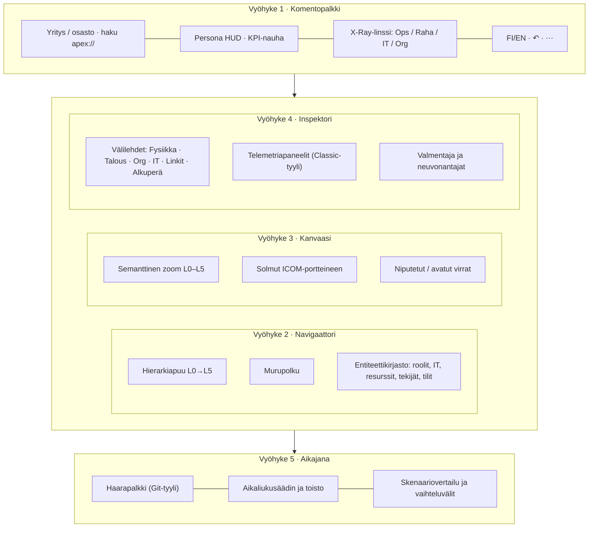
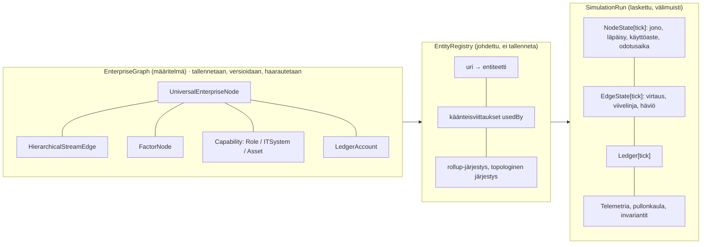
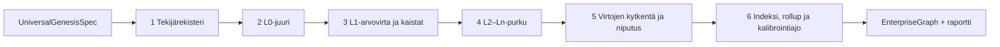

# APEX Studio – Technical Specification Document (TSD)

**Versio:** 3.2-PRO-SPEC · **Päivämäärä:** 24.10.2026 · **Korvaa:** v2.4-PRO-SPEC (v3.1 lisäsi kypsyystasot, v3.2 lisää neljä arkkitehtuuri-invarianttia A1–A4 (kohta 1.3). Kypsyystasot: kohdat 1.2 P9, 2.5, 3.3, 3.4, 4.1–4.4, 6.5, 7, 9, 10, 11, 12 ja 13)
**Tila:** Hyväksyttäväksi. Vaiheiden 1–2 toteutus voi alkaa hyväksynnän jälkeen.
**Koodipohja, josta analyysi on tehty:** `bjorkmeister/Apex` @ `6c974ce` (85/85 testiä läpi)

> [!IMPORTANT]
> **Yhden lauseen tiivistelmä:** APEX Studio v3.2 yhdistää Flow-ytimen reaktiivisen laskennan, Classic-näkymän ammattimaisen ulkoasun ja uuden toimialasta riippumattoman, fraktaalisen prosessigraafin. Graafi zoomautuu koko yrityksestä (L0) yksittäisiin tehtäviin, IT-järjestelmiin ja pääkirjatileihin (L5) – samalla moottorilla yhden hengen pajasta 50 000 hengen konserniin tai yksittäiseen osastoon. **Kypsyystaso (0 Idea … 3 Toiminta) määrää, kuinka paljon Studio avaa:** liikeideaa suunnitteleva ei saa eteensä valmista end-to-end-yritystä, vaan kyvykkyyskartan ja aukkoanalyysin siitä, mitä yrityksen toimiminen vielä vaatii.

---

## 0. Miten tämä dokumentti on syntynyt

Dokumentti syntetisoi kolme lähdettä:
1. **TSD v2.4** ja tiekartta: Business Molecules, Visual Flow Engine, Progressive Disclosure, valmentaja, Founder Launchpad, 7 persoonaa, SaaS-muisti.
2. **Toteutettu koodi** (vaiheet 1–14): Flow-ydin, kielituki, widgetit, skenaariot, neuvonantajat, sesongit.
3. **Uusi arkkitehtuurisuunnitelma (Design Log v3.0, lähde):** fraktaalinen prosessigraafi, ICOM-portit, semanttinen zoom, EntityURI, 8-vaiheinen Genesis, IT-mekanismit, X-Ray-linssit.

Design Log hyväksytään pääosin sellaisenaan. Siinä on kuitenkin muutama sisäinen ristiriita ja tekninen aukko, jotka on korjattu tässä dokumentissa (luku 12: *Tarkennukset ja korjaukset saapuneeseen spesifikaatioon*). Merkittävimmät:
- **Määritelmä ja ajonaikainen tila erotetaan.** Graafin rakenne (mitä yritys on) ja simulaation tila (mitä siellä juuri nyt tapahtuu) ovat eri tietorakenteet.
- **Käänteisviittaukset johdetaan indeksiksi** eikä niitä tallenneta käsin, jotta ne eivät voi ajautua ristiriitaan.
- **Classicin moottoriin ei sidota.** Sen hyvät mekaniikat siirretään uuteen moottoriin.
- **Toimialaenumit poistetaan kokonaan.** Design Login ensimmäisessä Genesis-luonnoksessa oli vielä mm. `seasonalityProfile: 'summer_peak'`, `operatingArchetype` ja `category: 'pos' | 'crm' | 'erp'`. Myöhempi `UniversalGenesisSpec` on oikea suunta, ja sitä käytetään.
4. **Käyttäjän lisäys 23.10.2026 (v3.1): kypsyystasot.** Idea-vaiheen suunnittelija ei voi saada valmista end-to-end-graafia. Studion pitää tukea keskeneräistä mallia ja näyttää puuttuvat osat (kohta 4.4). Tämä on sisällytetty kaikkiin asianomaisiin lukuihin, ei vain kohtaan 4.4.
5. **Käyttäjän lisäys 24.10.2026 (v3.2): neljä arkkitehtuuri-invarianttia** (kohta 1.3): yksi solmumalli (atomit ovat solmun fysiikkaa), Genesis ja Launchpad saumattomasti, spotlight-zoom ja kyvykkyyksien paljastuminen sekä kaksinopeuksinen optimistinen renderöinti. Sisällytetty lukuihin 1.3, 3.3, 3.5, 4.1, 4.5, 5, 6.3, 6.4, 8.1, 9, 10, 11, 12 ja 13.

---

## 1. Tavoitetila ja suunnitteluperiaatteet

### 1.1 Visio
APEX Studio on **liiketoiminnan digitaalinen kaksonen ja valmentaja**. Käyttäjä kuvaa yrityksen (tai sen osan) omin sanoin tai rakentaa sen itse. APEX kääntää kuvauksen toimivaksi prosessigraafiksi, jossa virrat, jonot, kapasiteetit, ihmiset, IT-järjestelmät ja raha kulkevat päivä päivältä. Käyttäjä voi zoomata ulos kokonaiskuvaan tai sisään yksittäiseen tehtävään, ja jokaisen luvun alkuperä ja vaikutukset voi jäljittää.

### 1.2 Periaatteet (sitovia)

| # | Periaate | Mistä | Miten se toteutuu v3.2:ssa |
| :-: | :-- | :-- | :-- |
| P1 | **Ehdoton toimiala-agnostisuus** | Käyttäjä, v2.4 | Skeemassa, kääntäjässä ja moottorissa ei ole yhtään toimialasanaa tai -enumia. Toimialat ovat dataa. Esimerkkipohjat ovat erillisiä datapaketteja. |
| P2 | **Ei automaattista ERP-monimutkaistumista** | v2.4 | Semanttinen zoom: näkyvä tarkkuus riippuu zoomista ja persoonasta, ei yrityksen koosta. |
| P3 | **Selkeys ensin, syvyys pyydettäessä** | v2.4 (Progressive Disclosure) | Oletusnäkymä L1. Syvemmät tasot avautuvat zoomaamalla tai klikkaamalla. |
| P4 | **Ei arvattuja lukuja** | v2.4, kritiikki | Kipurajat, vaihteluvälit käyttäjältä ja lähteelliset arviot. Jokaisella luvulla on alkuperä (`Provenance`). |
| P5 | **Tekoäly vain tarkistettujen komentojen kautta** | Vaihe 8 | Kielimalli tuottaa komentoja tai kuvauksia, ei suoritettavaa koodia. Kaikki validoidaan, ja kaiken voi kumota. |
| P6 | **Laskenta säilyy täsmäävänä** | Classic, Flow | Invariantit (luku 6.5): kassa, pääkirja ja virtojen massatase täsmäävät jokaisella tickillä. |
| P7 | **Kirjoita kerran, käännä työkalulla** | Vaihe 9 | Kaikki uusi käyttöliittymäteksti kulkee `t()`-funktion kautta. Classicin kovakoodattu suomi ei siirry sellaisenaan. |
| P8 | **Ammattimainen, tiheä mutta rauhallinen ulkoasu** | Classic + v2.4 | Classicin värit, ohuet viivat ja tasavälinumerot. Tiheyttä säätelevät zoom ja persoona (luku 2.4). |
| P9 | **Kypsyystaso ohjaa avautumista** | Käyttäjä 23.10.2026 | Studio ei avaa prosesseja, ostoa, myyntiä tai simulaatiota ennen kuin käyttäjä on päättänyt niistä (taso 0 Idea → 3 Toiminta, kohta 4.4). Keskeneräinen on sallittua, ja puuttuvat osat näytetään aukkoanalyysina eikä täytetä arvauksilla. |

### 1.3 Neljä arkkitehtuuri-invarianttia (A1–A4, sitovia)

Nämä estävät käsitteiden kahdentumisen, pitävät käyttöliittymän nollakitkaisena ja takaavat vasteajan. Jokaisella on hyväksymisehto, ja ne ovat testattavia.

| # | Invariantti | Tiivistelmä | Hyväksymisehto | Luvut |
| :-: | :-- | :-- | :-- | :-- |
| **A1** | **Yksi solmumalli** | `UniversalEnterpriseNode` on ainoa solmu kankaalla. Viisi atomia (aika ja kapasiteetti, aine ja varasto, jatkuva tilaus, tapahtuma ja kauppa, maksuaika ja sitoumus) ovat solmun sisäisiä fysiikkamoduuleita (`node.physics`), eivät erillinen molekyylimalli. | Kankaalla ja tallennetussa mallissa ei ole muuta solmutyyppiä. Jokaisella lehtisolmulla on vähintään yksi fysiikkamoduuli. | 3.3, 6.3 |
| **A2** | **Genesis ja Launchpad saumattomasti** | Yksi aloitusreitti. Fast-Track (yksi lause tai CSV/PDF) täyttää `UniversalGenesisSpec`:n taustalla ja piirtää graafin heti. Architect Mode avaa kaikki 8 vaihetta. `launchpad.ts` on kankaan päällä toimiva aktiivinen valmentaja, jonka valinnat kytkeytyvät ICOM-portteihin ja kassaan. | Käyttäjä ei koskaan käy läpi kahta velhoa. Launchpad-valinta muuttaa porttia tai kerrointa ja on kumottavissa. | 4.1, 4.5 |
| **A3** | **Fokusoitu zoom ja kyvykkyyksien paljastuminen** | Spotlight: sisään zoomattaessa vain valittu solmu ja sen 3–7 lasta ovat kirkkaita, ympäristö himmenee, ja tulo- ja lähtöportit pysyvät näkyvissä. Kyvykkyydet (roolit, järjestelmät, resurssit) paljastuvat tasoilla L2–L4 tai IT/Org-linssissä, ei L0–L1:llä. | L0–L1 näyttää vain makrovirran, kapasiteetin ja tilavärin. Spotlightissa ei näy muiden osastojen sisäosia. | 3.5, 5 |
| **A4** | **Kaksinopeuksinen arkkitehtuuri** | Nopeus 1: kaikki säätimet, valinnat ja kipurajat ajetaan paikallisesti selaimessa ilman kielimallikutsua (<16 ms). Nopeus 2: kielimallipyyntö luo heti (<50 ms) optimistisen luonnossolmun, ja asynkroninen kielimallikutsu hydratoi sen myöhemmin. Kielimallin viive ei koskaan blokkaa käyttöliittymää. | Kielimallikutsun aikana säätimet ja animaatiot toimivat normaalisti. Epäonnistuminen tai peruutus palauttaa tilan yhdellä siirtymällä. | 6.4, 8.1 |

> [!IMPORTANT]
> **A4 ja P4/P9:** optimistinen luonnossolmu ei saa tuoda arvattuja lukuja malliin. Se on `definition: "named"` ja merkitty luonnokseksi, eikä sen lukuja lasketa kassaan, pääkirjaan, KPI-nauhaan tai raporttiin ennen hydraatiota ja käyttäjän hyväksyntää. Esikatselu oletusarvoilla ajetaan erillisessä, selvästi merkityssä varjoajossa, jonka tuloksia ei tallenneta (kohta 8.1).


---

## 2. Unified Studio Shell – käyttöliittymäarkkitehtuuri

### 2.1 Viisi vyöhykettä



| Vyöhyke | Tehtävä | Siirtyy nykyisestä koodista |
| :-- | :-- | :-- |
| **1 Komentopalkki** | Identiteetti, globaali haku (`apex://`), Persona HUD, linssivalitsin, kieli, kumoa | `flow/client/app.ts` (yläpalkki, kieli, roolit, kumoa) + `app/war-room-view.ts` (telemetrianauha, tyyli) |
| **2 Navigaattori** | Hierarkiapuu L0→Ln, murupolku, entiteettikirjasto (roolit, IT, resurssit, tekijät, tilit) | Uusi |
| **3 Kanvaasi** | Semanttinen zoom, ICOM-solmut, niputetut virrat, linssit, partikkelivirrat | `flow/client/canvas.ts` (animaatio, kassasäiliö) + `components/ValueChainCanvas.ts` (sarakeasettelu, solmukortit, tyyli) |
| **4 Inspektori** | Valitun entiteetin välilehdet ja telemetriapaneelit, valmentaja, neuvonantajat, widgetit | `flow/client/drawer.ts`, `tools.ts`, `coach.ts`, `widgets.ts` + `components/*Drawer.ts` (asettelu ja visuaalinen kieli) + `WarRoomDebatePanel.ts` (keskustelun esitys) |
| **5 Aikajana** | Haarat, aikasiirto, skenaariovertailu, vaihteluvälit, tapahtumat | `flow/client/canvas.ts` (`renderTimeline`), `model/scenarios.ts` + `components/TimelineBranchBar.ts` (haarapalkin ulkoasu) |

Mobiili ja kapea näyttö: vyöhykkeet 2 ja 4 muuttuvat liukupaneeleiksi, ja vyöhyke 5 tiivistyy yhdeksi riviksi.

### 2.2 Väri- ja typografiatokenit (Classic → Studio)

Tokenit otetaan suoraan `src/app/styles.ts`:stä ja laajennetaan semanttisilla domeeniväreillä:

| Token | Arvo | Käyttö |
| :-- | :-- | :-- |
| `--bg-deep` | `#060b16` | Sivun pohja |
| `--bg-panel` | `#0c1426` | Vyöhykkeet 1, 2, 4, 5 |
| `--bg-card` | `#111c33` | Solmut, kortit |
| `--bg-hover` | `#172544` | Hover ja valinta |
| `--border` | `#1e2d4a` | 1 px rakenneviivat |
| `--border-bright` | `#38bdf8` | Fokus, valittu |
| `--text-main` / `--text-muted` / `--text-dim` | `#f1f5f9` / `#94a3b8` / `#64748b` | Tekstihierarkia |
| `--font-sans` / `--font-mono` | Inter / ui-monospace | Mono kaikille luvuille, `font-variant-numeric: tabular-nums` |
| **Semanttiset tilavärit** | | |
| `--st-healthy` | `#10b981` | Terve virta, tulo, tavoite täyttyy |
| `--st-warning` | `#f59e0b` | Jono kasvaa, kapasiteetti > 85 % |
| `--st-critical` | `#ef4444` | Pullonkaula, kassavaje, SLA-rikko |
| **Domeeniroolit (ArchiMate-kerros, ei toimiala)** | | |
| `--dom-demand` | `#38bdf8` | Kysyntä ja markkina (ulkoiset syötteet) |
| `--dom-value` | `#60a5fa` | Arvovirran ydinprosessit |
| `--dom-enabling` | `#818cf8` | Tukevat ja hallinnolliset prosessit |
| `--dom-application` | `#a78bfa` | IT-järjestelmät ja data |
| `--dom-finance` | `#34d399` | Rahavirrat ja pääkirja |
| `--dom-people` | `#f472b6` | Roolit ja organisaatio |

Huom: domeenivärit sidotaan **rooliin graafissa** (esim. "ulkoinen syöte", "ydinarvovirta", "mekanismi: sovellus"), ei toimialaan.

### 2.3 Neljä X-Ray-linssiä

Sama graafi piirretään neljällä tavalla. Linssi vaihtaa vain esitystapaa, ei laskentaa.

| Linssi | Solmun väri / täyttö | Virran paksuus / tyyli | Esiin nostettava |
| :-- | :-- | :-- | :-- |
| **Ops Flow** | Kapasiteetin käyttö (vihreä → keltainen → punainen) | Yksikköä / tick | Pullonkaula (ToC), jonot, odotusaika |
| **Financial Margin (Sankey)** | Kate-% | € / tick | Missä kate syöpyy (hävikki, logistiikka, hankintakulu) |
| **IT & Data** | Automaatioaste: manuaalinen (punainen katko), taulukko (keltainen), integroitu (syaani) | Datavirrat, viive, uudelleensyöttö | Käsin tehtävät siirrot, integraatiovelka |
| **Org & Accountability** | Omistava rooli / yksikkö | Luovutukset yksiköiden välillä | FTE-ylikuorma, RACI-aukot |

**Huom. tasot 0–1:** kyvykkyyskartta (`BusinessCapability`, kohta 3.3) piirretään omana näkymänään, ei linssinä. Linssit 1–4 aktivoituvat vasta, kun graafissa on määriteltyjä prosessisolmuja (taso 2+). IT & Data -linssi voi tasolla 1 näyttää suunnitellut järjestelmätarpeet ilman virtoja.

### 2.4 Tiheyden hallinta: Classic-tyyli ja selkeys samassa
Classicin ulkoasu on tiheä, ja v2.4:n periaate taas on "zen ja selkeys". Ristiriita ratkaistaan näin:
- **Tyyli (värit, viivat, tasavälinumerot) otetaan Classicista aina.**
- **Tiheys (montako lukua solmussa näkyy) määräytyy zoomin ja persoonan mukaan:** L0–L1 näyttää enintään 3 lukua solmua kohden, L2+ kaikki. Opiskelija ja perustaja näkevät oletuksena L1:n, COO ja analyytikko voivat lukita oletukseksi L2:n.
- **Päänäkymässä ei koskaan ole enempää kuin 8 ydinarvovirran laatikkoa ja 6 tukilaatikkoa** (L1-rajoite, luku 3.4).

### 2.5 Persona HUD ja Subsystem Scoping
Persona vaihtaa **KPI-nauhan, oletuszoomin, oletuslinssin, inspektorin välilehtien järjestyksen ja valmentajan sävyn**, ei laskentaa.

| Persona | KPI-nauha | Oletus |
| :-- | :-- | :-- |
| Opiskelija | Kassa, tulos, kannattavuusraja, aktiivinen tehtävä | L1 · Ops · *Opi:*-selitykset |
| Perustaja / yksinyrittäjä | Kassa, kuukausitulos, kannattavuusraja yksikköinä, pahin pullonkaula | L1 · Ops · perustamislista |
| Osa-aluejohtaja (Subsystem) | Oman alipuun tavoitteet ja rajapintojen tila | **L0 = oma alipuu** · Ops |
| COO / prosessi | Läpimenoaika, kapasiteetin käyttö, jonot, SLA-rikot, varaston kierto | L2 · Ops |
| Toimitusjohtaja | Kasvu, kate-%, kassa, pullonkaula, riskit | L1 · Raha |
| Valmentaja / tilitoimisto | Kassa, kate, maksuajat, toteuma vs. suunnitelma | L1 · Raha |
| Rahoittaja / VC | Liikevaihdon kasvu, kate-%, LTV:CAC, burn multiple, runway, vaihteluvälit | L0 · Raha |

**Oletuskypsyystaso persoonittain** (kohta 4.4): Opiskelija 3 valmiilla esimerkillä (tai 0 alusta opeteltaessa), **Perustaja ja liikeideaa suunnitteleva 0**, yrittäjä 3, osa-aluejohtaja 3 oman alipuun juurella, COO, toimitusjohtaja, neuvoja ja rahoittaja 3. Taulukon "Perustaja / yksinyrittäjä" -rivi (L1 · Ops) koskee tasoa 2–3. Tasolla 0–1 päänäkymä on **kyvykkyyskartta** (ei L1-prosessiketju), ja KPI-nauhana ovat aukkojen määrä, tuntemattomat kulut ja avoimet huomioitavat asiat. Persoona vaihtaa vain oletuksen, ja käyttäjä voi aina vaihtaa tasoa itse.

**Subsystem Scoping** on v3.2:ssa graafioperaatio: käyttäjä valitsee minkä tahansa solmun "juureksi". Näkymä rajautuu sen alipuuhun. Solmun ICOM-portit näkyvät ulkoisina rajapintoina, joiden kautta muu yritys syöttää ja vastaanottaa virtoja. Tämä toteuttaa v2.4:n osa-aluejohtajan näkymän yleisesti, esimerkiksi myynnille, yksittäiselle tehtaalle tai IT-osastolle.

---

## 3. Universal Enterprise Meta-Graph

### 3.1 Standardit ja niiden rooli

| Standardi | Mitä APEX siitä käyttää | Mitä APEX ei ota |
| :-- | :-- | :-- |
| **APQC PCF** | Tasojen semantiikka (L0–L5) ja valinnainen kanoninen luokitustunniste `canonicalRef` vertailua ja raportointia varten | Ei pakollista 13 kategorian rakennetta. Taksonomian upottaminen dataan edellyttää lisenssiehtojen tarkistusta. |
| **IDEF0 (IEEE 1320.1)** | Neljän sivun porttikielioppi ICOM: Input (vasen), Control (ylä), Output (oikea), Mechanism (ala) | Ei IDEF0-kaavionotaatiota sellaisenaan |
| **ArchiMate 3.x** | Kerrosajattelu: Strategia → Liiketoiminta → Sovellus → Data → Talous. Domeenivärit, ristiinviittaukset | Ei koko elementtikirjastoa |
| **System Dynamics + VSM** | Varannot (jonot, puskurit), virrat (nopeudet), viiveet, läpimenoaika, odotusaika, läpäisy | Ei jatkuva-aikaista differentiaaliyhtälömallia: APEX simuloi diskreetein tickein |
| **Business Molecules (v2.4)** | Viisi atomia pysyvät valmiina laskentapalikoina, jotka käännetään graafin aliverkoiksi (luku 7.3) | – |

### 3.2 Arkkitehtuurin tärkein korjaus: määritelmä ≠ ajonaikainen tila



Design Login skeemassa ajonaikaiset arvot (`currentStockVolume`, `waitQueueTimeComputed`) ja käänteisviittaukset (`usedByEntityURIs`) olivat määritelmäolioissa. Se johtaisi kolmeen ongelmaan:
1. Skenaarion haarautus kopioisi tilaa, jonka pitäisi syntyä laskemalla.
2. Kumoaminen ja vertailu muuttuisivat epäluotettaviksi.
3. Käänteisviittaukset ajautuisivat ristiriitaan.

v3.2:ssa **määritelmä on ainoa tallennettava totuus**. Indeksi ja ajo johdetaan siitä deterministisesti.

### 3.3 Tietomalli (TypeScript-sopimukset)

Sijainti: `src/flow/graph/` (uusi selain- ja Node-yhteensopiva hakemisto, sama tyyppien riisuntamalli kuin `kernel/`). Design Log ehdotti `src/core/schema/meta-graph.ts`:ää. Uusi graafi kuitenkin sijoitetaan Flow-puolelle, koska `src/core` on Classicin moottori, joka poistetaan (luku 9).

```typescript
// src/flow/graph/types.ts — määritelmä (tallennettava). Ei toimialasanoja.

/** apex://<tyyppi>/<id>. Tyyppi on rakenteellinen, ei toimiala. */
export type EntityURI = `apex://${EntityType}/${string}`;
export type EntityType = "node" | "stream" | "unit" | "factor" | "role" | "system" | "asset" | "account" | "policy" | "kpi" | "unit-org";

export type FlowNature =
  | "discrete"        // laskettavat kappaleet, toimeksiannot, tapaukset, toimitukset
  | "continuous"      // määrät: massa, energia, kaistanleveys, laskenta
  | "agent"           // ihmiset tai toimijat: asiakkaat, liidit, potilaat, hakijat
  | "signal"          // tieto: tilaukset, hyväksynnät, API-kutsut, dokumentit
  | "monetary"        // raha: kassa, laskut, budjetit
  | "capacity";       // aika tai kapasiteetti: työtunnit, konetunnit, palveluajat

export interface FlowUnit {
  uri: EntityURI;
  name: string;                 // käyttäjän tai toimialan data, esim. "Toimeksianto"
  nature: FlowNature;
  measure: string;              // "kpl", "h", "kg", "kutsua/s"
  /** Vanheneminen jonossa (pilaantuminen, liidin jäähtyminen, asiakkaan luopuminen). */
  decayPerTick: FactorRef;
}

/** Viittaus lukuun: joko vakio tai FactorNode. */
export type FactorRef = { const: number } | { factor: EntityURI };

export interface FactorNode {
  uri: EntityURI;
  name: string;
  kind: "constant" | "lever" | "formula" | "external_signal";
  value: number;                // vakio tai vivun arvo
  unit: string;
  /** Turvallinen kaavakieli (src/flow/model/formula.ts). Muuttujat ovat muiden tekijöiden URI-aliaksia. */
  formula?: string;
  /** Aikafunktio: kausikerroin, kasvu, aalto (korvaa toimialakohtaiset kausienumit). */
  temporal?: { periodTicks: number; amplitude: number; phaseTicks: number }[];
  provenance?: Provenance;      // olemassa oleva src/flow/kernel/types.ts
}

export type PortSide = "I" | "C" | "O" | "M";

export interface Port {
  id: string;
  name: string;
  side: PortSide;
  unit: EntityURI;              // FlowUnit
  /** Resepti: montako tätä yksikköä tarvitaan / syntyy yhtä solmun suoritusta kohden. */
  ratio: FactorRef;
  /** O-puolella: ensisijainen tuotos, hylky/uudelleentyö, sivutuote tai pääkirjakirjaus. */
  role?: "primary" | "reject" | "byproduct" | "posting";
  /** Kun solmu puretaan, mihin lapsisolmun porttiin tämä portti kytkeytyy. */
  delegatesTo?: { node: EntityURI; port: string };
}

/** A1: viisi atomia ovat solmun fysiikkamoduuleita. Ei kuudetta tyyppiä: tavallinen työvaihe (esim. hyväksyntä) kuvataan `time_capacity`-moduulilla. */
export type AtomKind =
  | "time_capacity"            // AtomTimeCapacity: kalenteriaika, käyttöaste, työpisteet, peruutukset
  | "physical_matter"          // AtomPhysicalMatter: raaka-aine, varasto, hävikki, vanheneminen, toimitusaika
  | "recurring_subscription"   // AtomRecurringSubscription: toistuva tulo, poistuma, hankintakulu
  | "transactional_trade"      // AtomTransactionalTrade: asiakasvirta, keskiostos, välitön maksu
  | "credit_working_capital";  // AtomCreditWorkingCapital: maksuajat, ennakot, kassakuilu

/** Jokainen moduuli palauttaa saman rakenteen, jonka solmu yhdistää (yhdistämissäännöt kohdassa 6.3). */
export interface PhysicsOutput {
  capacityPerTick: number;     // suorituksia / tick ennen mekanismien kertoimia
  cycleTicks: number;          // arvoa lisäävä aika
  firstPassYield: number;      // 0..1, loput reject-porttiin
  variableCost: number;        // € / suoritus
  fixedCostPerTick: number;
  queueDecayPerTick?: number;  // jonon vanheneminen tai luopuminen
  cash?: { amount: number; delayTicks: number }[];   // kassavaikutus ja sen viive
}
export interface PhysicsModule {
  atom: AtomKind;
  /** Moduulin parametrit (nimet määrää `src/flow/kernel/atoms.ts`:n vastaava atomi). Luvut ovat FactorRef-viitteitä, joten alkuperä säilyy. */
  params: Record<string, FactorRef>;
  batchSize?: FactorRef;
}

export interface UniversalEnterpriseNode {
  uri: EntityURI;
  name: string;
  level: number;                          // 0 = juuri; ei ylärajaa (L5 on suositus, ei raja)
  band: "value_stream" | "enabling" | "governance" | "external";
  /** v3.1: onko solmu määritelty. "named" = nimetty ja kuvattu, ei vielä sisältöä. "unknown" = tiedetään tarvittavan, ei tiedetä miten. Oletus "defined". Simulaattori ei laske muita kuin "defined" (kohta 4.4). */
  definition?: "defined" | "named" | "unknown";
  /** v3.1: mitä liiketoimintakyvykkyyttä solmu toteuttaa (valinnainen). */
  realizes?: EntityURI[];
  tags: string[];                         // vapaat käyttäjän tunnisteet
  canonicalRef?: string;                  // valinnainen APQC/SCOR/BIZBOK-viite
  parent: EntityURI | null;
  children: EntityURI[];                  // tyhjä = lehtisolmu, jolla on oma fysiikka
  ports: Port[];
  /** Vain lehtisolmuilla: oma muunnosfysiikka. Koostesolmun luvut lasketaan lapsista. */
  /** A1: solmun sisäinen fysiikka. Lehtisolmulla vähintään yksi moduuli. Koostesolmun luvut lasketaan lapsista. */
  physics?: PhysicsModule[];
  /** Valinnainen varanto solmun sisääntulossa (jono, puskuri, varasto, putki). */
  buffer?: { maxUnits: FactorRef; holdingCostPerUnit: FactorRef; reorder?: { trigger: FactorRef; target: FactorRef; source: EntityURI } };
  /** Mekanismit eli alaportit: kuka/mikä tekee työn ja millä kertoimilla. */
  mechanisms: MechanismBinding[];
  /** A4: true = optimistinen luonnossolmu (ei vielä hydratoitu). Lukuja ei lasketa kassaan, pääkirjaan, KPI:hin eikä raporttiin. */
  ghost?: { patchId: string; status: "pending" | "hydrated" | "failed"; requestedAt: number };
  owner?: EntityURI;                      // RACI: vastuullinen rooli
  ledgerBindings: { event: "on_complete" | "on_reject" | "per_tick"; debit: EntityURI; credit: EntityURI; amount: FactorRef }[];
  kpis: EntityURI[];
}

export interface MechanismBinding {
  capability: EntityURI;                  // role | system | asset
  /** Kapasiteetti, jonka tämä mekanismi tuo (esim. FTE × tunnit × tuottavuus). */
  capacityContribution?: FactorRef;
  /** Kertoimet solmun fysiikkaan (IT-järjestelmät, automaatio). */
  modifiers?: { throughput?: FactorRef; cycleTime?: FactorRef; yield?: FactorRef; variableCost?: FactorRef };
  /** Käyttöönotto: viive ja muutoksen notkahdus (Design Log: change management dip). */
  rollout?: { startTick: number; leadTicks: number; dipDepth: FactorRef; dipTicks: number };
  /** Riippuvuus: jos kyvykkyys ei ole käytettävissä, solmu pysähtyy tai siirtyy varatilaan. */
  critical: boolean;
  fallbackMultiplier?: FactorRef;
}

export interface HierarchicalStreamEdge {
  uri: EntityURI;
  name: string;
  parent: EntityURI | null;               // niputettu emovirta
  children: EntityURI[];                  // purkautuvat alivirrat
  from: { node: EntityURI; port: string };
  to: { node: EntityURI; port: string };
  unit: EntityURI;
  routing: { kind: "direct" } | { kind: "split"; share: FactorRef } | { kind: "condition"; when: string } | { kind: "overflow"; priority: number };
  latencyTicks: FactorRef;                // logistiikka, käsittely, API-viive, maksuaika
  lossRate: FactorRef;                    // kuljetusvaurio, liidin putoaminen, paketin häviö
  transferCost: FactorRef;
}

export type Capability =
  | { kind: "role"; uri: EntityURI; name: string; orgUnit: EntityURI; fte: FactorRef; costPerFtePerTick: FactorRef; hoursPerFtePerTick: FactorRef; proficiency: FactorRef }
  | { kind: "system"; uri: EntityURI; name: string; layer: "capture" | "workflow" | "record" | "intelligence" | "agent"; fixedCostPerTick: FactorRef; capex: FactorRef; availability: FactorRef }
  | { kind: "asset"; uri: EntityURI; name: string; capacityPerTick: FactorRef; operatingCostPerTick: FactorRef; capex: FactorRef; usefulLifeTicks: FactorRef };

/** v3.1: liiketoimintakyvykkyys ("mitä yrityksen pitää osata"), ei sama kuin Capability (mekanismi: rooli, järjestelmä, resurssi). Taso 0–1 rakentuu näistä. */
export interface BusinessCapability {
  uri: EntityURI;
  name: string;
  status: "known" | "unclear" | "missing";
  rationale?: string;                     // miksi tämä tarvitaan (datapohjasta tai käyttäjältä)
  dependsOn: EntityURI[];                 // muut BusinessCapability-viitteet
  notes: { kind: "cost" | "risk" | "obligation" | "question"; text: string; amount?: FactorRef }[];
  canonicalRef?: string;                  // valinnainen ulkoinen viite (lisenssi tarkistettava)
  realizedBy: EntityURI[];                // prosessisolmut, kun taso 2+
  provenance: "user" | "genesis" | "template";
}

export interface LedgerAccount {
  uri: EntityURI;
  code: string;                           // käyttäjän tilikartta
  name: string;
  type: "asset" | "liability" | "equity" | "revenue" | "expense";
}

export interface EnterpriseGraph {
  version: 3;
  /** v3.1: 0 Idea, 1 Konsepti, 2 Toimintamalli, 3 Toiminta. Oletus 3 (migraatio). */
  maturity?: 0 | 1 | 2 | 3;
  id: string;
  name: string;
  root: EntityURI;
  tick: { resolution: "hour" | "day" | "week" | "month"; horizon: number };
  currency: string;
  nodes: Record<string, UniversalEnterpriseNode>;
  streams: Record<string, HierarchicalStreamEdge>;
  units: Record<string, FlowUnit>;
  factors: Record<string, FactorNode>;
  capabilities: Record<string, Capability>;
  businessCapabilities?: Record<string, BusinessCapability>;   // v3.1
  accounts: Record<string, LedgerAccount>;
  opening: { cash: number; balances: Record<string, number> };
  events: GraphEvent[];                   // kriisit ja tapahtumat (yleistys nykyisestä BusinessEventista)
}
```

> [!NOTE]
> **Tietoinen valinta:** IT-järjestelmän kerros (`capture`, `workflow`, `record`, `intelligence`, `agent`) on rakenteellinen luokitus. Se kertoo, mitä järjestelmä tekee prosessille. "POS", "CRM" ja "ERP" ovat järjestelmän nimiä eli dataa, eivät tyyppejä. Näin IT-kerros pysyy agnostisena.

### 3.4 Tasot ja ydinarvovirran rajoitteet

| Taso | Merkitys | Rajoite näkymässä |
| :-- | :-- | :-- |
| **L0** | Koko organisaatio (tai valittu alipuu) yhtenä laatikkona | 1 laatikko, makroportit |
| **L1** | Päästä päähän -arvovirta + tuki- ja hallintakaistat | Ydinarvovirta 2–8 laatikkoa, tukikaistat 0–6 |
| **L2** | Prosessiryhmät | Näkyy zoomatessa yhteen L1-laatikkoon |
| **L3** | Prosessit | – |
| **L4–L5** | Aktiviteetit, tehtävät, säännöt | Rajaton syvyys, suositus enintään 5 |

**Tasot ja kypsyystaso:** L0–L5 koskevat prosessisolmuja eli kypsyystasoa 2–3. Tasolla 0–1 graafissa on L0-juuri ja `BusinessCapability`-solmut, ja L1-rajoite (2–8 arvovirtalaatikkoa) ei koske kyvykkyyskarttaa. Kun taso nostetaan 2:een, kyvykkyyksistä ehdotetaan prosessisolmuja (`realizes`/`realizedBy`), mutta ei luoda niitä ilman käyttäjän hyväksyntää.

Jos käyttäjän malli ylittää L1-rajan (esim. 11 ydinvaihetta), kääntäjä ehdottaa ryhmittelyä yhteisen emosolmun alle. Mitään ei hävitetä.

### 3.5 Semanttinen zoom – solmut ja virrat

- **Zoom ei ole skaalausta vaan tarkkuustason vaihto.** Kanvaasi näyttää "näkyvän rajauksen" eli joukon solmuja, joiden lapsia ei avata.
- **Siirtymät:** < 25 % → L0, 25–60 % → L1, > 60 % → avataan se solmu, johon zoomataan (kursorin alla). Tuplaklikkaus avaa solmun. Murupolku ja Esc palaavat ylös.
- **Virtojen niputus:** kun kahden näkyvän solmun välillä kulkee yksi tai useampi lehtitason virta, ne piirretään yhtenä koostevirtana. Paksuus = yhteenlaskettu virtaus valitussa linssissä. Klikkaus tai zoom purkaa koostevirran työ-, tieto- ja rahavirroiksi.
- **Spotlight Viewport Isolation (A3):** kun käyttäjä zoomaa tai tuplaklikkaa L1- tai L2-solmuun, näkymä rajautuu siihen: valittu solmu ja sen **3–7 osaprosessia** (lasta) piirretään kirkkaina, muu graafi himmenee (opasiteetti ~15 %, ei klikattavissa, sisuksia ei piirretä) ja solmun reunoille jäävät näkyviin tulo- ja lähtöportit sekä niihin kytkeytyvien virtojen koostevirrat. Esc, murupolku tai ulkopuolen klikkaus palauttaa. Jos lapsia on yli 7, ensimmäiset 7 näytetään kapasiteettijärjestyksessä ja loput ryhmitellään "+N muuta" -solmuun (ryhmittelyehdotus kohdan 3.4 mukaan). **Ero Subsystem Scopingiin:** spotlight on tilapäinen näkymäefekti, jossa laskenta ja juuri pysyvät ennallaan. Scoping vaihtaa juuren (kohta 2.5).
- **Kyvykkyyksien luonnollinen paljastuminen (A3):** L0–L1 näyttää vain makrovirran, kokonaiskapasiteetin ja tilavärin (jos kriittinen mekanismi puuttuu tai on ylikuormitettu, se näkyy tilavärinä ilman yksityiskohtia). **Mekanismit (`M`-portin kyvykkyydet: roolit ja FTE:t, IT-järjestelmät, fyysiset resurssit) avautuvat vasta tasoilla L2–L4** tai kun IT & Data- tai Org & Accountability -linssi on aktiivinen (linssi saa avata ne myös L1:llä). Avautuessaan ne piirretään solmun alareunaan omina kapseleinaan, joissa kapasiteetti ja kriittisyys.
- **Koostevirta lasketaan aina lehtivirroista.** Käyttäjä voi nimetä koostevirran, mutta sillä ei ole omaa fysiikkaa.

### 3.6 EntityURI ja rajaton ristiinviittaus
- Jokaisella entiteetillä on URI. Haku (vyöhyke 1) ja inspektorin **Linkit**-välilehti näyttävät käänteisviittaukset: missä tätä tekijää, roolia, järjestelmää tai tiliä käytetään, millä tasolla, ja mihin KPI:hin se vaikuttaa.
- **Tarkenna graafiin** panoroi ja zoomaa kanvaasin entiteetin solmuun ja tasolle.
- **Käänteisindeksi johdetaan aina määritelmästä** (`buildRegistry(graph)`) eikä sitä tallenneta.
- Kaavoissa tekijöihin viitataan aliaksella (`price`, `node.sales.capacity`). Aliakset ratkaistaan URI:iksi, joten nimen vaihto ei riko kaavoja.

---

## 4. Genesis-to-Operations

### 4.1 Kahdeksan vaihetta (`UniversalGenesisSpec`)

| # | Vaihe | Kysymys | Kääntyy graafiksi |
| :-: | :-- | :-- | :-- |
| 1 | **Ongelma ja tehtävä** | Miksi organisaatio on olemassa? Mitä se tavoittelee? | L0-juuri, tavoite-KPI:t, kysynnän laukaisuehdot |
| 2 | **Ratkaisu ja reseptit** | Mitä arvoyksiköitä syntyy, ja mitä niihin kuluu? | FlowUnit-ontologia, reseptit (I→O-suhteet), sykli, saanto |
| 3 | **Markkina** | Mikä ulkoinen ympäristö ja aikadynamiikka? | Ulkoiset tekijät C-portteihin: katto, jousto, aikafunktiot, säännöt |
| 4 | **Asiakkaat ja kanavat** | Kuka kuluttaa, miten hänet saavutetaan, miten hän käyttäytyy? | Hankinta- ja vastaanottoputket (N vaihetta), jonotoleranssi, pysyvyys |
| 5 | **Hankinta** *(valinnainen)* | Mitä hankitaan ulkoa? | Toimittajasolmut, täydennyssäännöt, viiveet, eräkoot, I-puskurit |
| 6 | **Liiketoimintamalli** | Miten arvo muuttuu tuloksi ja kassaksi? | Hinnoittelu, laskutusväli, myyntisaamiset ja ostovelat, pääkirjakirjaukset |
| 7 | **Kyvykkyydet** | Ketkä, millä järjestelmillä ja resursseilla tekevät työn? | Roolit, järjestelmät ja resurssit M-portteihin kertoimineen |
| 8 | **Topologia ja hallinta** | Lähtötaso, pääoma, hierarkia, SLA-rajat | L0→L3-puu, avaava tase, hallintaportit, aikaresoluutio |

**Kypsyystaso (kohta 4.4):** vaiheet 1–8 ovat käytettävissä millä tahansa tasolla. Tasolla 0 ne täytetään kyvykkyyksinä ja avoimina kysymyksinä (esim. vaihe 5 Hankinta → "tiedetäänkö toimittajat?" → tila `unclear`), ei prosesseina. Vaiheiden täyttöaste näkyy aukkoanalyysissä.

**Nopea tila:** yksi lause → kielimalli täyttää spesifikaation → validointi → kaikki täytetyt kentät merkitään `provenance: "genesis"`. Ilman kielimallia nykyinen `ideaToMolecule` toimii varapolkuna.
**Arkkitehtitila:** jokaisen vaiheen voi täyttää tai korjata käsin, ja jokainen vaihe voidaan ohittaa oletuksilla.
**Perustamislista** (`launchpad.ts`) ei ole Genesis-vaihe eikä toinen aloitusvelho. Se on kankaan päällä toimiva aktiivinen valmentaja (kohta 4.5, A2). Ruksi muuttaa tekijöitä ja portteja samalla tavalla kuin nyt (esim. YEL lisää roolille kulun, maksuehto muuttaa virran viivettä), ja ruksin poisto palauttaa muutoksen.

Spesifikaatio otetaan Design Login `UniversalGenesisSpec`-sopimuksesta sellaisenaan kahdella muutoksella:
1. `itAndAutomationSystems[].systemLayer` käyttää kohdan 3.3 kerroksia.
2. Kaikki luvut ovat `FactorRef`-muotoa, jotta alkuperä säilyy.

### 4.2 Kuuden vaiheen kääntäjä (`src/flow/graph/compiler.ts`)



0. **Tasoportti (v3.1):** `graph.maturity` määrää, mitkä vaiheet 1–6 ajetaan. Taso 0–1: vain vaihe 1–2 (tekijät ja L0) sekä `BusinessCapability`-solmut ja aukkoanalyysi (`gaps.ts`). Taso 2: vaiheet 1–5, solmuja voi olla `named`/`unknown`. Taso 3: kaikki vaiheet, kuten alla.
1. **Tekijärekisteri:** jokaisesta luvusta tulee FactorNode, jolla on alkuperä.
2. **L0:** juurisolmu ja makroportit vaiheista 3–7.
3. **L1:** solmuja syntyy vain, jos ontologia niitä vaatii:
   - hankinta, jos vaihe 5 on käytössä,
   - kysyntä ja hankintaputki vaiheesta 4,
   - muunnos vaiheen 2 resepteistä,
   - toimitus ja tilitys vaiheesta 6.
   Tuki- ja hallintakaistat tulevat vaiheista 7–8.
4. **L2–Ln:** putkien vaiheet, reseptin askeleet ja laatuportit (saanto < 1 tuottaa hylky- tai uudelleentyöhaaran) sekä laskutus, saamiset ja kassa.
5. **Virrat:** lehtivirrat (työ, tieto, raha) kytketään ensin, ja niistä johdetaan koostevirrat ylemmille tasoille.
6. **Indeksi, rollup ja kalibrointi:** käänteisindeksi ja yksi koeajo tarkistavat invariantit (luku 6.5) ja tunnistavat päivän 1 pullonkaulan. Jos invariantti rikkoutuu, graafia ei hyväksytä.

**Deterministisyys:** sama spesifikaatio tuottaa aina saman graafin (vakaat tunnisteet sisällön tiivisteestä). Kielimalli osallistuu vain spesifikaation täyttämiseen, ei kääntämiseen.

### 4.3 Rakenteellinen kehitys simulaation aikana
Design Login kolme operaatiota toteutetaan graafikomentoina (`GraphCommand`, luku 8), ja jokainen voidaan ajaa uudessa skenaariohaarassa:
- **Purku (mitoosi):** lehtisolmu → N lasta. Portit delegoidaan lapsille ja URI säilyy. **Kalibroitu purku:** lasten oletusarvot asetetaan niin, että koosteen kapasiteetti, kulut ja läpimenoaika vastaavat purkua edeltävää tilaa, jolloin tuloksiin ei synny hyppäystä.
- **Ylennys:** lapsisolmu siirretään ylemmälle tasolle (esim. tehtävästä osastoksi).
- **Monistus:** alipuu kopioidaan N kertaa (esim. toimipisteet tai kanavat), ja kopiot jakavat yhteiset ylävirran puskurit.
- **Kehityspohjat** (Design Log: Structural Evolution Blueprints) ovat datapaketteja, joita valmentaja tarjoaa, kun pullonkaula on rakenteellinen.

---

### 4.4 Kypsyystaso (`VentureMaturity`): Studio ei avaa enempää kuin mitä on päätetty

**Ongelma, jonka TSD:n ensimmäinen luonnos (v3.0) ratkaisi puutteellisesti:** kohdan 4.2 kääntäjä tuottaa aina koko end-to-end-graafin. Henkilö, joka vasta suunnittelee liikeideaa (esim. uusi tuotebrändi), ei tiedä vielä mitä yritys tekee, joten ostojen, myynnin ja tuotannon avaaminen on väärin. Studion pitää sen sijaan auttaa rakentamaan ne osat, joita yrityksen toimiminen vaatii, ja näyttää mitkä puuttuvat.

**Kypsyystaso on mallin ominaisuus** (`graph.maturity`), ja se rajaa mitä kääntäjä tuottaa ja mitä käyttöliittymä näyttää:

| Taso | Nimi | Graafissa | Studio tekee |
| :-: | :-- | :-- | :-- |
| 0 | **Idea** | Vain L0-juuri ja **kyvykkyyskartta** (kyvykkyydet nimettyinä, ei prosesseja) | Ohjattu kysely. Jokaiselle kyvykkyydelle tila: `tiedossa`, `epäselvä` tai `puuttuu` |
| 1 | **Konsepti** | Valittujen kyvykkyyksien sisäinen suunnittelu (esim. tuotekehitys, hankinta, sääntely, rahoitus) | Selkokielinen yhteenveto: puuttuvat osat, kulut, uhat, huomioitavat asiat ja valmistautumislista |
| 2 | **Toimintamalli** | Prosessit hahmoteltu (solmut ja virrat), mutta osa määrittelemättä | Ohjattu prosessisuunnittelu. Aukkoanalyysi: mitä yritys vielä tarvitsee toimiakseen |
| 3 | **Toiminta** | Koko end-to-end-graafi, simulointi päällä | Kohdan 4.2 kääntäjä sellaisenaan |

**Säännöt:**
1. **Keskeneräisyys on sallittu graafissa.** Solmun `definition` on `defined`, `named` (nimetty, ei sisältöä) tai `unknown`. Simulaattori ei laske `named`- tai `unknown`-solmuja oletusarvoilla: ne jätetään pois laskennasta ja raportoidaan selkeästi ("ei laskettu, koska määrittelemätön"). Invarianttitestit (6.5) koskevat vain `defined`-osaa.
2. **Taso on aina käyttäjän päätös.** Studio voi ehdottaa seuraavaa tasoa ("kyvykkyydet 1–4 on määritelty, haluatko hahmotella prosessit?"), mutta ei nosta tasoa itse.
3. **Genesis noudattaa tasoa.** Vaiheet 1–8 (4.1) ovat käytettävissä tasosta riippumatta, mutta kääntäjä (4.2) tuottaa vain tason mukaisen graafin. Täyden end-to-end-graafin luominen on tason 3 valinta, ei oletus.
4. **Aukkoanalyysi (`gaps.ts`):** vertaa kyvykkyyskarttaa kyvykkyysmalliin ja palauttaa luettelon (kyvykkyys, tila, miksi se tarvitaan, mikä sen puuttumisesta seuraa). Sama luettelo ruokkii selkokielistä yhteenvetoa ja perustamislistaa.
5. **Kyvykkyysmalli ja huomioitavat asiat ovat dataa, eivät koodia.** Pohjat (esim. sääntelyvaatimukset, tyypilliset kulut ja uhat) ladataan data-tiedostoista toimialan ja kokoluokan mukaan. Koodissa ei ole toimialakohtaisia oletuksia (kosmetiikkabrändi, nakkikioski ym. ovat vain esimerkkidataa).
6. **Kyvykkyysluokituksen lähde:** Business Technology Standardin termistön käyttöoikeus on tarkistettava ennen sen suoraa käyttöä. Siihen asti käytetään omaa yleistä kyvykkyysluokitusta (`src/flow/graph/capabilities/`), joka on yhteensopiva muiden viitekehysten kanssa valinnaisten `canonicalRef`-viitteiden kautta (kuten APQC).

**Persoonien oletuskypsyystasot:**

| Persoona | Oletustaso | Huomio |
| :-- | :-- | :-- |
| Opiskelija | 3 valmiilla esimerkkimallilla, tai 0 opetettaessa yritystä alusta | Selityskerros käsitteille (kate, kassavirta, DSO) |
| Liikeideaa suunnitteleva | **0** | Selkokielinen riski- ja valmistautumisyhteenveto, ei end-to-end-graafia |
| Toimiva yrittäjä | 3 | Nykyinen toiminta |
| Osa-aluejohtaja | 3, rajattuna oman alueen alipuuhun | Rajapinnat ulospäin vain virtoina |
| Toimitusjohtaja, neuvoja, rahoittaja | 3 | |

**Tyyppimuutokset (jo kirjattu kohtaan 3.3):** `EnterpriseGraph.maturity: 0 | 1 | 2 | 3`; `ProcessNode.definition: "defined" | "named" | "unknown"`; uusi `BusinessCapability` (tila: `known | unclear | missing`, perustelu, riippuvuudet muihin kyvykkyyksiin). Kaikki uudet kentät ovat valinnaisia, jotta nykyiset mallit migroituvat ilman muutoksia (oletus: taso 3, kaikki `defined`).

**Hyväksymisehdot:**
- Taso 0 -malli ei sisällä yhtään prosessisolmua eikä simulaatiota, ja aukkoyhteenveto tuotetaan kolmella toisistaan poikkeavalla esimerkillä ilman koodimuutoksia.
- `named`/`unknown`-solmut eivät vaikuta yhteenvetolukuihin, ja raportti kertoo ne erikseen.
- Tason nosto ja lasku on kumottavissa, eikä poista käyttäjän syöttämää tietoa.

### 4.5 Fast-Track, Architect Mode ja elävä Launchpad (A2)

**Yksi aloitusreitti, kaksi syvyyttä:**

| Tila | Käyttäjä | Mitä tapahtuu |
| :-- | :-- | :-- |
| **Fast-Track** | Syöttää yhden lauseen tai pudottaa CSV/PDF-tiliotteen | Kielimalli (lause) tai `importer.ts` (tiliote) täyttää `UniversalGenesisSpec`:n 8 vaihetta taustalla. Kääntäjä (4.2) piirtää graafin heti. Käyttäjälle ei näytetä lomakkeita |
| **Architect Mode** | COO, rahoittaja, konsultti | Avaa kaikki 8 vaihetta suoraan, ja jokainen voidaan täyttää tai ohittaa |

**Säännöt:**
1. **Syvyyden määrää kypsyystaso (4.4).** Fast-Trackin tulos on L0–L2 tasolla 2, tai koko graafi tasolla 3. Tasolla 0–1 se on kyvykkyyskartta ja aukkoanalyysi. Käyttäjä voi aina vaihtaa tasoa.
2. **Tuotu data ja arvaus erotetaan.** Tiliotteesta tulevat luvut ovat `provenance: "import"` (todellisia). Yhden lauseen perusteella täytetyt luvut ovat `provenance: "genesis"` eli arvioita, ja ne merkitään näkyvästi (P4).
3. **Nopeus (A4):** lauseen kielimallikutsu ei blokkaa. Paikallinen `ideaToMolecule`-heuristiikka luo heti luonnoskaavion (ghost-solmut, kohta 8.1), ja kielimallin vastaus hydratoi sen. Ilman avainta paikallinen heuristiikka on varapolku.
4. **Launchpad on kankaan päällä:** kun graafi on piirretty, Launchpad näyttää tarkistuslistan ja etenemispalkin (Y-tunnus, YEL, maksuehdot, rekryt, työkalut). Jokainen kohta on kirjattu **kytkentänä**: kohde (solmu tai virta, ICOM-portti), muutettava kerroin tai kassavaikutus, ja sen kumoaminen. Esim. maksuehto → virran `latencyTicks` (C-portti), YEL → roolin `costPerFtePerTick` (M-portti), työkalu → `MechanismBinding`. Ruksaaminen ajaa tavallisen `GraphCommand`-komennon paikallisesti (<16 ms), ei kielimallikutsua.
5. **Launchpad ja kypsyystaso:** tasolla 0–1 tehtävälista johdetaan aukkoanalyysistä. Tasolla 2–3 se on kytkentälista yllä olevan mukaan.

**Hyväksymisehdot:** (a) saman sisällön tuottaa Fast-Track ja Architect Mode täsmälleen samaksi graafiksi (determinismi), (b) Launchpad-ruksi muuttaa tunnettua porttia/kerrointa ja kassakuvaajaa, ja kumoaminen palauttaa alkutilan, (c) yhden lauseen syötön ensimmäinen kuva ilmestyy <50 ms.

---

## 5. Mekanismit: organisaatio, IT ja resurssit

> **A3:** mekanismit piirretään näkyviin vasta tasoilla L2–L4 tai IT/Org-linssissä (kohta 3.5). Tässä luvussa kuvattu laskenta toimii kuitenkin aina kaikilla tasoilla.

- **Kapasiteetti lehtisolmussa** = min(oma kapasiteetti, roolien tuoma kapasiteetti, resurssien kapasiteetti) × järjestelmien läpäisykertoimet × käyttöönottonotkahdus × saatavuus.
- **IT-järjestelmä** ei tuota rahaa. Se muuttaa fysiikkaa (läpäisy, sykli, saanto, muuttuva kulu) ja datavirtojen viivettä ja virheastetta, ja sillä on kiinteä kulu ja investointi.
- **Käyttöönotto:** viive ennen kuin hyöty alkaa, sen jälkeen hetkellinen notkahdus.
- **Riippuvuus:** kriittisen järjestelmän tai resurssin katko (tapahtuma) pysäyttää solmun tai siirtää sen varakertoimelle.
- **Organisaatio:** roolit kuuluvat organisaatioyksiköihin. FTE-kuorma = vaadittu työ ÷ käytettävissä oleva kapasiteetti, ja se näkyy Org-linssissä.
- **Pääkirja:** solmujen `ledgerBindings` ja rahavirrat kirjaavat kahdenkertaisesti. Tuloslaskelma, tase ja kassavirtalaskelma johdetaan pääkirjasta. Classicin `ledger.ts`-logiikka (`postJournal`, `buildIncomeStatement`, `buildBalanceSheet`) irrotetaan `WorldState`-riippuvuudesta neutraaliksi moduuliksi `src/flow/graph/ledger.ts`.

---

## 6. Simulaatiomoottori (`src/flow/graph/simulate.ts`)

### 6.1 Ajomalli
Diskreetti tick (oletus päivä, kuten nykyisessä ytimessä). Jokaisella tickillä:
1. Tekijät lasketaan (kaavat, aikafunktiot, tapahtumat) topologisessa järjestyksessä.
2. Ulkoiset lähteet (kysyntä, toimittajat) tuottavat yksiköitä.
3. Viivelinjat (virrat, joilla on latenssi) luovuttavat erääntyneet yksiköt kohdepuskureihin, ja häviö vähennetään.
4. Lehtisolmut käsitellään topologisessa järjestyksessä (takaisinkytkennät, kuten uudelleentyö, saavat yhden tickin viiveen): suoritukset = min(kapasiteetti, saatavilla olevat syötteet ÷ reseptisuhde, puskuritilan raja). Syötteet kulutetaan, tuotokset lasketaan saannon mukaan (primary / reject), ja kulut ja kirjaukset tehdään.
5. Jonojen vanheneminen ja luopuminen lasketaan, ja täydennyssäännöt laukaistaan.
6. Telemetria, pullonkaula (ToC: korkein kysyntä ÷ kapasiteetti kriittisellä polulla) ja invariantit tarkistetaan.

### 6.2 Koosteet (rollup)
Design Login kaavat (min kriittisellä polulla, summa läpimenoajasta) pätevät vain sarjaketjuissa. v3.2 laskee koosteet ajon tuloksista:
- **Läpäisy** = tuotosporttien virtaus.
- **Kapasiteetti** = virtauspainotettu pullonkaula (sama tulos kuin min sarjaketjussa, oikea myös rinnakkais- ja jakohaaroissa).
- **Läpimenoaika** = Littlen laki koostetasolla: keskimääräinen WIP ÷ läpäisy.
- **Kulut** = lasten summa + oma kiinteä kulu.

### 6.3 Atomit solmun fysiikkana (A1)

Ei ole kahta solmujärjestelmää. `src/flow/kernel/atoms.ts` toimii laskentakirjastona, jota solmun `physics`-moduulit kutsuvat:
- **Moduuli = atomi:** jokainen `PhysicsModule` laskee `PhysicsOutput`:n (läpimeno, viive, jono, hävikki, kassavaikutus) kutsumalla vastaavan atomin puhdasta laskentafunktiota. Kaavat ja `FlowAtom`-reaktiivisuus säilyvät. Vaihe 2 tarkistaa, että funktiot ovat uudelleenkäytettävissä sellaisenaan, ja jos eivät, atomien rajapinta puhdistetaan (testit suojaavat).
- **Yhdistämissäännöt (solmu, jolla useita moduuleita):** kapasiteetti = pienin moduulien kapasiteeteista (sarjassa kuten kriittinen polku), läpimenoaika = summa, saanto = tulo, kulut = summa, kassavaikutukset = yhdistetty lista. Rinnakkaiset moduulit (esim. kaksi kanavaa) mallinnetaan erillisinä solmuina, ei moduuleina.
- **Esimerkit (vain dataa):** palvelutyö = `time_capacity` + `credit_working_capital`; verkkokauppa = `physical_matter` + `transactional_trade`; ohjelmistotuote = `recurring_subscription`.
- **Migraatio (`migrateMoleculeToGraph`):** nykyinen molekyylimalli käännetään solmuiksi, joiden `physics`-moduulit ovat sen atomeja. Tämän jälkeen molekyyli on vain tuontimuoto, ei toinen rinnakkainen malli.
- **Varjoajo ja kultaiset testit:** neljälle esimerkkimallille graafimoottorin kuukausitulos, kassa ja kassan loppumispäivä vastaavat nykyistä molekyyliajoa toleranssilla 0,5 %. Tämä on vaiheen 2 hyväksymiskriteeri.
- **Herkkyys ja vaihteluvälit:** `sensitivity.ts` ja `stress.ts` laskevat graafin tekijöille samoilla puhtailla funktioilla. Siirtymän aikana ne toimivat vanhan adapterin kautta, kunnes yleistys (V5) on valmis.

### 6.4 Suorituskykybudjetti
- Vivun veto → uudelleenlaskenta ja piirto **< 16 ms**, kun malli on enintään 300 lehtisolmua × 360 tickiä. Pidempi horisontti tai suurempi malli lasketaan Web Workerissa, ja ensin näytetään kuukausitason likiarvo.
- Vaihteluvälit (400 ajoa) Web Workerissa, tavoite < 2 s.
- **Kaksi nopeutta (A4):**
  - **Nopeus 1 (<16 ms):** säätimet, Launchpad-valinnat, parametrimuutokset, IT-työkalujen kytkennät ja kipurajalaskenta ajetaan täysin paikallisesti ilman kielimallikutsua. Mallit, jotka ylittävät budjetin (yli 300 lehteä × 360 tickiä), lasketaan Workerissa ja piirretään edellinen tulos sekä kuukausitason likiarvo, kunnes valmis. Monte Carlo ei kuulu 16 ms:n budjettiin vaan Workeriin (tavoite < 2 s, edistymispalkki).
  - **Nopeus 2:** kielimallipyyntö luo ghost-solmun alle 50 ms:ssa (kohta 8.1). Kielimallin viive ei koskaan blokkaa pääsäiettä, animaatioita eikä säätimiä.
  - **Mittaus:** selaintesti mittaa vasteajan sekä säätimen vedosta että ghost-solmun ilmestymisestä. Raja on testattava (kohta 10).

### 6.5 Invariantit (rikkoutuminen = testi epäonnistuu)
1. **Pääkirja:** debet = kredit jokaisella tickillä.
2. **Kassa:** kassan muutos = rahavirtojen summa = pääkirjan kassatilin muutos.
3. **Massatase** jokaiselle FlowUnitille, jonka nature ≠ signal: sisään = ulos + varannon muutos + häviö + vanheneminen.
4. **Koosteet:** emosolmun luvut = lasten luvut (toleranssi 1e-6).
5. **Determinismi:** sama graafi ja siemen → sama tulos.
6. **Keskeneräisyys (v3.1):** invariantit 1–4 koskevat vain `defined`-solmuja. `named`/`unknown`-solmu ei tuota virtoja, kuluja eikä kirjauksia, eikä sitä korvata oletusluvuilla. Raportti ja KPI-nauha kertovat "ei laskettu" ja syyn. Jos `defined`-solmun tuleva virta on `named`/`unknown`-solmusta, virta merkitään katkenneeksi (`stub`) ja aukkoanalyysi nostaa sen esiin.

---

## 7. Säilyvät ja nousevat ominaisuudet

| v2.4 / toteutettu ominaisuus | v3.2:ssa |
| :-- | :-- |
| Business Molecules (5 atomia) | Atomipohjat graafiin + nopea viitetoteutus (6.3) |
| Visual Flow Engine (partikkelit, kassasäiliö) | Kanvaasin animaatiokerros. Säiliö säilyy L0:n kassasolmussa ja Raha-linssissä. |
| Progressive Disclosure | Semanttinen zoom + inspektorin välilehdet |
| Kipurajat (`sensitivity.ts`), stressitesti, vaihteluvälit | Toimivat graafitekijöille: mikä tahansa FactorNode voi olla stressattava tai epävarma |
| Valmentaja, neuvonantajat, keskustelu (In-Flight Mutation) | Komennot laajenevat graafikomentoihin (luku 8). Neuvonantajat keskustelevat valitusta solmusta ja pullonkaulasta (Classicin keskusteluesitys). |
| Founder Launchpad | Genesis-vaiheet 6–8 + hallintatehtävät |
| Tiliotteen tuonti, toteuma | Tuonti kohdistaa kulut pääkirjatileille ja solmuihin. Toteuma verrataan solmu- ja tilitasolla. |
| Widgetit (prompt-to-widget) | Kaavakieli käyttää graafin tekijäaliaksia |
| Skenaariot ja aikakone | Git-tyylinen haarautus graafimäärittelyille, haaran aloitusticki, vertailu aikajanalla |
| Sesongit ja kriisit | Aikafunktiot ja `GraphEvent` kohdistettuna mihin tahansa solmuun, virtaan tai kyvykkyyteen |
| Persoonat, osa-alueet, tavoitteet | Persona HUD + Subsystem Scoping alipuun juurena + KPI-entiteetit |
| Lukujen alkuperä | Jokaisella FactorNodella `provenance` |
| Kielituki | Kaikki uusi UI `t()`-kutsun kautta. Classicin tekstit käännetään siirron yhteydessä. |
| Raportti | Lisäksi prosessikartta (L1), IT-kartta ja organisaatiokuorma |
| SaaS-muisti (v2.4 luku 4) | Vaihe 7+ (pilvi). Graafi on valmiiksi sarjallistettava ja versioitava. |

---

## 8. Graafikomennot (In-Flight Mutation v2)

Nykyinen `FlowCommand` laajennetaan `GraphCommand`-joukoksi. Kielimalli, valmentaja, Genesis ja käyttäjän toiminnot käyttävät samaa validoitua rajapintaa:

`add_node`, `remove_node`, `decompose_node`, `promote_node`, `replicate_subgraph`, `connect_stream`, `split_stream`, `set_factor`, `set_formula`, `attach_capability`, `detach_capability`, `add_capability`, `add_event`, `set_owner`, `bind_ledger`, `set_root_scope`.

Jokainen komento:
1. validoidaan (viitatut URI:t olemassa, ei syklejä hierarkiassa, porttien yksiköt yhteensopivat),
2. ajetaan puhtaana funktiona (uusi graafi),
3. kirjaa alkuperän,
4. on kumottavissa.

Nykyiset `FlowCommand`-komennot käännetään graafikomennoiksi adapterilla, joten nykyinen keskustelu ja valmentaja toimivat koko siirtymän ajan.

### 8.1 Optimistinen renderöinti ja asynkroninen hydraatio (A4)

```typescript
// src/flow/graph/optimistic.ts (uusi)
export interface OptimisticNodePatch {
  patchId: string;
  request: string;                        // käyttäjän pyyntö sellaisenaan
  localCommands: GraphCommand[];          // paikallisen intent.ts:n tuottama luonnos (alle 50 ms)
  ghostNodes: EntityURI[];                // luodut luonnossolmut (definition: "named", ghost.status: "pending")
  baseVersion: number;                    // graafin versio, johon patch perustuu (rollback)
  status: "pending" | "hydrated" | "failed" | "cancelled" | "rolled_back";
}
export interface AsyncLLMHydration {
  patchId: string;
  streamed: GraphCommand[];               // orchestrator.ts: validoidut komennot, jotka saapuvat paloina
}
```

**Kulku:**
1. **<50 ms:** paikallinen `intent.ts` tunnistaa pyynnön (avainsanat ja nykyinen `commands.ts`-sovitin), luo `add_node`-luonnoksen ja kytkee ghost-solmun virtaan. Ghost piirretään katkoviivalla ja merkinnällä "luonnos, odottaa tarkennusta". Partikkelianimaatio kulkee ghostin kautta, mutta se on **vain visuaalinen**.
2. **Taustalla:** `orchestrator.ts` kutsuu kielimallia (avain: käyttäjän oma), ja vastaus validoidaan `GraphCommand`-komentoina kuten aina (P5). Kielimalli ei tuota koodia.
3. **Hydraatio:** validoidut komennot kohdistetaan ghost-solmuun palasina (streaming patch). Solmun `definition` muuttuu `named` → `defined` ja `ghost.status` → `hydrated`, ja käyttäjä hyväksyy tai muokkaa sen (hyväksyntä tallentaa alkuperän `genesis`).
4. **Rollback:** epäonnistuminen, aikakatkaisu, validointivirhe tai peruutus palauttaa graafin versioon `baseVersion` yhdellä tilasiirtymällä (ghost poistuu, muu pysyy). Epäonnistumisesta näytetään selkeä viesti ja uudelleenyritys.
5. **Käyttäjän muokkaus kesken hydraation:** jos käyttäjä muokkaa ghostin kenttää ennen vastausta, hänen arvonsa säilyvät ja LLM-vastaus ei ylikirjoita niitä (`provenance: "user"` voittaa).

**Erityissäännöt (ristiriidat P4/P9:n kanssa ratkaistu):**
- **Ghost-solmun lukuja ei lasketa** kassaan, pääkirjaan, KPI-nauhaan, raportteihin, kipurajoihin tai Monte Carloon (kuten kaikkia `named`-solmuja, kohta 6.5/6). Luonnoksella ei siis voi tehdä päätöksiä.
- **Esikatselu oletusarvoilla** on vapaaehtoinen: erillinen varjoajo (`SimulationRun`), jonka tulokset on merkitty "arvaus, oletusarvoilla" eikä niitä tallenneta mallin mukana.
- **Pino:** useita pyyntöjä voi olla käynnissä. Kumoa-toiminto kohdistuu viimeisimpään.

---

## 9. Kuiluanalyysi: nykyinen koodi → v3.2

### 9.1 Säilytetään ja laajennetaan (Flow)

| Tiedosto | Rooli v3.2:ssa | Muutos |
| :-- | :-- | :-- |
| `flow/kernel/atoms.ts`, `simulate.ts`, `stress.ts`, `events.ts`, `sensitivity.ts` | Atomien viitetoteutus, kipurajat, vaihteluvälit | `atomToSubgraph`-adapteri, stressi ja Monte Carlo yleistyvät FactorNodeille |
| `flow/kernel/types.ts` | `Provenance`, `BusinessEvent` | Siirtyy osin `graph/types.ts`:ään |
| `flow/model/formula.ts` | Turvallinen kaavakieli tekijöille | Aliasten ratkaisu URI:iksi, riippuvuusgraafi (topologinen järjestys) |
| `flow/model/provenance.ts` | Alkuperä | Avaimena URI |
| `flow/model/commands.ts` | Komentosopimus | → `GraphCommand` + adapteri |
| `flow/model/coach.ts`, `advisors.ts` | Valmentaja, neuvonantajat | Säännöt graafin telemetrian päälle: pullonkaula, jonot, IT-katkot, FTE-kuorma |
| `flow/model/genesis.ts` | Liikeidea → malli | → `UniversalGenesisSpec` + nopea tila. Nykyinen jää varapoluksi. |
| `flow/model/launchpad.ts` | Perustamislista | → hallintatehtävät Genesis-vaiheissa 6–8 |
| `flow/model/importer.ts`, `actuals.ts` | Tiliote, toteuma | Kohdistus tileihin ja solmuihin |
| `flow/model/widgets.ts`, `scenarios.ts`, `seasons.ts`, `goals.ts`, `founder.ts`, `tasks.ts`, `report.ts`, `personas.ts` | Ominaisuudet | Lähteeksi graafi |
| `flow/i18n/*` | Kielituki | Ei muutoksia. Uudet tekstit lisätään. |
| `flow/server/*` | Reitit, tekoäly, sivu | `page.ts`: Classic-tokenit ja viiden vyöhykkeen runko. `ai.ts`: Genesis- ja graafikomennot. |
| `flow/client/canvas.ts` | Animaatio, aikajana | → semanttisen zoomin kanvaasi (uusi `graph-canvas.ts`). Partikkeli- ja säiliökoodi säilyy. |
| `flow/client/app.ts`, `drawer.ts`, `tools.ts` | UI | → viiden vyöhykkeen kuori, inspektorin välilehdet |

### 9.2 Siirretään Classicista (ulkoasu ja mekaniikka, ei sellaisenaan)

| Classic | Mitä siirretään | Miksi ei sellaisenaan |
| :-- | :-- | :-- |
| `app/styles.ts` | Tokenit, viivat, tasavälinumerot, korttien ja taulukoiden tyylit | – (siirretään suoraan) |
| `components/ValueChainCanvas.ts` | Solmukorttien rakenne, sarakeasettelu, pullonkaulan korostus | Sidottu `WorldState`:n kiinteisiin sarakkeisiin ja `IndustryArchetype`-enumiin (agnostisuusrikko) |
| `components/FinancialTelemetryDrawer.ts` | Tuloslaskelman, taseen ja kassavirran esitys | Lukee `WorldState`:a, sisältää kovakoodattua suomea |
| `components/WarehouseAndOpsDrawer.ts` | Käyttöaste-, jono- ja virtausvisualisoinnit | Fyysinen varasto (`usedVolumeM3`) on toimialaoletus → yleistetään puskureiksi |
| `components/OrgAndCapabilityDrawer.ts` | FTE-, palkka- ja kuormanäkymä | `roleHeadcount`, `capabilityFriction` sidottu Classic-skeemaan |
| `components/TimelineBranchBar.ts` | Haarapalkin ulkoasu ja vertailu | Classic-haarat kopioivat koko `WorldState`:n |
| `components/WarRoomDebatePanel.ts` | Neuvonantajakeskustelun esitystapa | Sidottu Classic-agentteihin |
| `components/CrisisModal.ts` | Kriisikortin esitystapa | Sidottu Classic-tapahtumiin |
| `core/engine/ledger.ts` | Kahdenkertainen kirjanpito, tuloslaskelma, tase | Irrotetaan `WorldState`:sta → `graph/ledger.ts` |
| `core/engine/supply.ts`, `warehouse.ts`, `operations.ts`, `org.ts` | Ideat: täydennyssäännöt, eräkoot, vanheneminen, osaamiskitka | Toteutetaan yleisinä puskuri-, virta- ja mekanismisääntöinä |
| `core/llm/*` | Kielimalliasiakas (BYOK), markkinahaku | Säilyy jaettuna palveluna (`client.ts` on jo yhteinen) |

### 9.3 Poistetaan, kun vastine on valmis
`src/app/server.ts` (paitsi palvelimen käynnistys ja `/classic` siirtymäajan), `src/app/war-room-view.ts`, `src/components/*`, `src/core/schema/*`, `src/core/compiler/*`, `src/core/engine/*` (paitsi irrotettu pääkirja), `src/core/agents/*`. Classicin 21 testiä korvataan graafimoottorin vastaavilla ennen poistoa.

### 9.4 Suurimmat kuilut

| Kuilu | Koko | Ratkaisu |
| :-- | :-: | :-- |
| Graafisimulaattori (jonot, reseptit, viiveet, saanto, pääkirja) puuttuu | Suuri | Vaihe 2, varjoajo atomiytimen kanssa |
| Semanttisen zoomin kanvaasi (hierarkia, niputus, asettelu) puuttuu | Suuri | Vaihe 2. Asettelu: kaistat × topologinen järjestys (deterministinen, ei voimapohjaista asettelua) |
| Pääkirja on sidottu `WorldState`:een | Keskikokoinen | Irrotus vaiheessa 2 |
| Classicin paneelit sidottu `WorldState`:een, kovakoodattu suomi | Keskikokoinen | Uudelleenkirjoitus graafidataan, ulkoasu Classicista, vaihe 1 (tilapäisesti atomidatalla) ja vaihe 4 (graafidata) |
| Genesis on yhden lauseen tulkki, ei 8 vaihetta | Keskikokoinen | Vaihe 3 |
| IT- ja organisaatiomekanismit puuttuvat | Keskikokoinen | Vaihe 4 |
| Kaksi solmumallia: molekyylimalli (`kernel`) ja uusi `UniversalEnterpriseNode` (A1) | Suuri | V2: atomit solmun `physics`-moduuleiksi, `migrateMoleculeToGraph`, kultaiset testit. Molekyyli jää vain tuontimuodoksi |
| Genesis ja Launchpad ovat erillisiä aloituspolkuja (A2) | Keskikokoinen | V3: Fast-Track (lause, CSV) → `UniversalGenesisSpec` → graafi, Launchpad kankaan päälle kytkentöinä |
| Ei spotlightia eikä tasokohtaista kyvykkyyksien paljastamista (A3) | Keskikokoinen | V1: spotlight (atomidatalla), V2: kyvykkyyskapselit graafidatalla |
| Kielimalliviive blokkaa chatin ja komennot (A4) | Suuri | V4: `intent.ts`, `OptimisticNodePatch`, ghost-solmu, rollback. V5: `orchestrator.ts`, streaming-hydraatio |
| Kypsyystasot: nykyinen malli olettaa aina valmiin yrityksen, ei keskeneräistä | Suuri | V2: `maturity`, `definition`, `BusinessCapability` tyyppeihin. V3: `gaps.ts`, kyvykkyysmalli dataksi (`src/flow/graph/capabilities/`), Genesis ja kääntäjä tasoportilla. V1: persoonan oletustaso ja kyvykkyyskartta-näkymä |
| Nykyinen `launchpad.ts` ja `genesis.ts` olettavat toimivan yrityksen | Keskikokoinen | Muutetaan tasoriippuviksi (V3). Perustamislista toimii tasolla 2–3, tasolla 0–1 sitä vastaa aukkoanalyysi |
| Tallenteiden migraatio (v1-molekyyli → v3-graafi) | Pieni | `migrateMoleculeToGraph` vaiheessa 2 |

---

## 10. Testaus- ja hyväksymisstrategia
- **Nykyiset 85 testiä pysyvät vihreinä** koko siirtymän ajan. Classicin testit poistetaan vasta vaiheessa 6 yhdessä Classicin kanssa.
- **Uudet testiryhmät:**
  - graafin validointi,
  - kääntäjän determinismi,
  - invariantit (6.5) satunnaisgraafeilla (ominaisuuspohjainen testaus, siemen),
  - kultaiset testit (6.3),
  - zoom ja niputus (koostevirta = lehtivirtojen summa),
  - komennot ja kumoaminen,
  - agnostisuustesti: skeema- ja kääntäjätiedostoissa ei toimialasanalistan sanoja.
- **Kypsyystestit (v3.1):**
  - taso 0 -malli: ei prosessisolmuja eikä simulaatiota, ja aukkoyhteenveto syntyy ilman koodimuutoksia vähintään kolmella toisistaan poikkeavalla datapohjalla;
  - `named`/`unknown`-solmut eivät vaikuta yhteenvetolukuihin, ja raportti listaa ne erikseen;
  - tason nosto ja lasku on kumottavissa eikä poista syötettyä tietoa;
  - migraatio: vanha malli → `maturity: 3`, kaikki `defined`, kultaiset testit ennallaan;
  - agnostisuustesti kattaa myös kyvykkyysmallin koodin (data saa sisältää toimialasanoja, koodi ei).
- **Invarianttitestit (v3.2):**
  - A1: kankaan solmut ovat kaikki `UniversalEnterpriseNode` ja jokaisella lehdellä on ≥1 `PhysicsModule`; molekyylimalli ei ole tallennusmuoto;
  - A2: Fast-Track ja Architect Mode tuottavat samasta syötteestä samat graafit; Launchpad-ruksi + kumoaminen palauttaa alkutilan;
  - A3: L0–L1:llä ei piirretä mekanismikapseleita; spotlightissa muiden osastojen sisuksia ei ole DOM:ssa; spotlight ei muuta laskentatulosta;
  - A4: säätimen vedon vasteaika <16 ms (300 lehteä × 360 tickiä); ghost-solmu <50 ms; kielimallikutsun (simuloitu 5 s viive) aikana säätimet toimivat; epäonnistuminen/peruutus palauttaa tilan; ghostin luvut eivät näy KPI:ssä eikä raportissa.
- **Selaintestit:** CDP-ajot jokaisesta vyöhykkeestä, zoomista ja linssistä. Konsolin on oltava puhdas.

---

## 11. Riskit

| Riski | Todennäköisyys | Vaikutus | Hallinta |
| :-- | :-: | :-: | :-- |
| Graafimoottorin ja atomiytimen tulokset eroavat | Keskisuuri | Suuri | Kultaiset testit ennen kuin UI siirtyy käyttämään graafia |
| Kanvaasin asettelu sotkeutuu suurilla malleilla | Suuri | Keskisuuri | L1-rajoite, kaistat, niputus, deterministinen asettelu, ryhmittelyehdotus |
| Suorituskyky suurilla malleilla | Keskisuuri | Keskisuuri | Budjetti 6.4, Web Worker, kuukausitason likiarvo |
| Laajuus kasvaa yli toteutuskyvyn | Suuri | Suuri | Vaiheistus, jokaisen vaiheen jälkeen toimiva sovellus, Classic poistetaan vasta lopuksi |
| Monimutkaisuus palaa käyttöliittymään ("ERP-ähky") | Keskisuuri | Suuri | P2 ja P3 sitovina, L1-oletus, tiheys zoomin mukaan |
| Studio tarjoaa keskeneräisen mallin "vakuuttavana" valmiina yrityksenä (väärä turvallisuuden tunne) | Keskisuuri | Suuri | `named`/`unknown`-solmut näkyvät selvästi, simulaatio ohittaa ne, raportti kertoo mitä ei laskettu |
| Kyvykkyysmallin datapohja on puutteellinen tai väärä (esim. sääntelyvaatimukset) | Keskisuuri | Suuri | Pohjissa lähde ja päivämäärä, merkintä "ei oikeudellista neuvontaa", käyttäjä voi muokata. Pohjat ovat dataa ja päivitettävissä ilman koodimuutosta |
| Business Technology Standardin / APQC:n lisenssi | Pieni | Pieni | Oma yleinen luokitus oletuksena, `canonicalRef` valinnainen |
| Ghost-solmu hämää käyttäjää (luonnos luullaan oikeaksi) | Keskisuuri | Suuri | Katkoviiva, selvä merkintä, ei lukuja KPI:hin tai raporttiin, esikatselu erillisenä varjoajona |
| Atomien laskentafunktiot eivät ole sellaisenaan uudelleenkäytettävissä solmun moduuleina | Keskisuuri | Keskisuuri | V2:n alussa rajapinnan tarkistus, rajapinnan puhdistus ja kultaiset testit |
| Moduulien yhdistämissäännöt (6.3) eivät sovi kaikkiin toimintatapoihin | Keskisuuri | Keskisuuri | Rinnakkaisuus omina solmuina, kultaiset testit ja uudet atomit/moduuliyhdistelmät vain tarvittaessa |
| APQC-taksonomian lisenssi | Pieni | Pieni | `canonicalRef` valinnainen, ei upoteta ilman ehtojen tarkistusta |

---

## 12. Tarkennukset ja korjaukset saapuneeseen spesifikaatioon

| # | Design Log / lähde | v3.2-päätös | Perustelu |
| :-: | :-- | :-- | :-- |
| 1 | Sidotaan Flow-ydin `src/core/engine`-fysiikkaan | **Ei sidota.** Classicin mekaniikat siirretään graafimoottoriin, pääkirja irrotetaan. | Classic-moottori olettaa kiinteän `WorldState`-muodon, mikä on ristiriidassa agnostisuuden (P1) kanssa. Sitominen veisi jäykkyyden uuteen ytimeen. |
| 2 | Classicin paneelit integroidaan `app.ts`:ään | Ulkoasu ja rakenne siirretään, data ja tekstit kirjoitetaan uudelleen | Paneelit lukevat `WorldState`:a, ja niissä on kovakoodattua suomea (P7) |
| 3 | `meta-graph.ts` hakemistoon `src/core/schema/` | `src/flow/graph/` | `src/core` poistuu. Uusi koodi selain- ja Node-yhteensopivaan hakemistoon. |
| 4 | Ajonaikainen tila (`currentStockVolume`, `waitQueueTimeComputed`) solmussa | Erillinen `SimulationRun` | Haarautus, kumoaminen ja determinismi (luku 3.2) |
| 5 | `usedByEntityURIs` tallennetaan | Johdettu indeksi | Estää ristiriidat |
| 6 | Ensimmäinen Genesis-luonnos: `operatingArchetype`, `seasonalityProfile: 'summer_peak'`, IT `category: 'pos'…` | Poistettu. Käytetään `UniversalGenesisSpec`:iä, aikafunktioita ja IT-kerroksia. | P1 |
| 7 | Rollup: min kriittisellä polulla, summa syklistä | Ajosta johdettu: virtauspainotettu pullonkaula, Littlen laki | Design Login kaavat pätevät vain sarjaketjuissa |
| 8 | Zoom-kynnykset kiinteinä prosentteina | Kynnykset + tuplaklikkaus + murupolku + kursoriin kohdistettu avaus | Saavutettavuus ja ennustettavuus |
| 9 | APQC 13 kategoriaa pohjana | Valinnainen `canonicalRef`. Rakenne syntyy ontologiasta. | Agnostisuus ja lisenssi |
| 10 | Kääntäjä 5 vai 6 vaihetta (Design Log esitti molemmat) | 6 vaihetta (luku 4.2) | Indeksointi ja kalibrointi omaksi vaiheekseen |
| 11 | Esimerkkien (nakkikioski, SaaS, konsultointi, tehdas) nimet | Vain testi- ja esimerkkidatassa | P1 |
| 12 | Genesis päättyy aina "Generate End-to-End Business Operations" | Kypsyystasoportti: end-to-end on tason 3 valinta, ei oletus (4.2 vaihe 0, 4.4) | Idea-vaiheen suunnittelija ei voi saada valmista yritystä, jota ei ole vielä päätetty |
| 13 | Kaksi rinnakkaista solmumallia: molekyylit ja `UniversalEnterpriseNode`, ja `atomToSubgraph` luo osagraafeja | Atomit ovat solmun `physics`-moduuleja (A1, 6.3). `atomToSubgraph` korvautuu `migrateMoleculeToGraph`:lla | Yksi malli, ei duplikoituvia käsitteitä |
| 14 | Launchpad siirtyy Genesis-vaiheisiin 6–8 hallintatehtäviksi (TSD v3.0) | Launchpad on kankaan päällä toimiva valmentaja (A2, 4.5) | Yksi aloitusreitti, ei kahta velhoa |
| 15 | Optimistinen ghost-solmu "alustavalla partikkelivirralla oletusarvoilla" | Ghost on visuaalinen, `named`, eikä sen lukuja lasketa. Esikatselu erillisenä merkittynä varjoajona (8.1) | P4 (ei arvattuja lukuja) ja kypsyystasosääntö |
| 16 | "Zoomaa L2–L4:llä, näytä 3–7 osaprosessia" | Spotlight näyttää 3–7 lasta, ylimenevät ryhmitellään (3.5). Eri asia kuin Subsystem Scoping | Yhtenäisyys L1-rajan (2–8) ja scopingin kanssa |
| 17 | Kaikki säätimet <16 ms | Pätee ≤300 lehteä × 360 tickiä, isommat ja Monte Carlo Workerissa edistymispalkilla (6.4) | Rehellinen, mitattava raja |

---

## 13. Sanasto

| Termi | Merkitys |
| :-- | :-- |
| **ICOM** | IDEF0:n neljä porttia: Input, Control, Output, Mechanism |
| **Lehtisolmu** | Solmu, jolla ei ole lapsia ja jolla on oma fysiikka |
| **Koostesolmu** | Solmu, jonka luvut lasketaan lapsista |
| **Koostevirta** | Niputettu virta, joka koostuu lehtivirroista |
| **FactorNode** | Mikä tahansa luku: vakio, vipu, kaava tai ulkoinen signaali |
| **Kyvykkyys (`Capability`)** | Mekanismi: rooli, järjestelmä tai resurssi, joka kytketään M-porttiin |
| **Liiketoimintakyvykkyys (`BusinessCapability`)** | Mitä yrityksen pitää osata toimiakseen (esim. tuotekehitys, hankinta, sääntelyn hallinta). Taso 0–1 rakentuu näistä. Eri asia kuin `Capability` |
| **Fysiikkamoduuli (`PhysicsModule`)** | Yksi viidestä atomista solmun sisällä. Laskee läpimenon, viiveen, jonon, hävikin ja kassavaikutuksen (A1) |
| **Fast-Track** | Aloitus yhdellä lauseella tai CSV/PDF:llä. Spesifikaatio täytetään taustalla (A2) |
| **Architect Mode** | Kaikkien 8 Genesis-vaiheen suora muokkaus (A2) |
| **Spotlight** | Zoomattaessa vain valittu solmu, sen 3–7 lasta ja portit ovat kirkkaita, muu himmenee (A3) |
| **Ghost-solmu / `OptimisticNodePatch`** | Optimistinen luonnos, joka piirretään heti ja hydratoidaan kielimallilla myöhemmin. Ei lukuja malliin (A4) |
| **Kypsyystaso (`maturity`)** | 0 Idea, 1 Konsepti, 2 Toimintamalli, 3 Toiminta. Määrää mitä Studio avaa |
| **Aukkoanalyysi (`gaps.ts`)** | Luettelo kyvykkyyksistä, joiden tila on `unclear` tai `missing`, perusteluineen ja seurauksineen |
| **`named` / `unknown`** | Solmun määrittelyaste: nimetty ilman sisältöä / tiedetään tarvittavan, ei tiedetä miten. Simulaatio ohittaa |
| **Tick** | Simulaation aika-askel (oletus päivä) |
| **Kalibroitu purku** | Solmun purku lapsiksi niin, että tulokset eivät hyppää |
| **Varjoajo** | Uusi moottori ajetaan vanhan rinnalla ja tuloksia verrataan |
