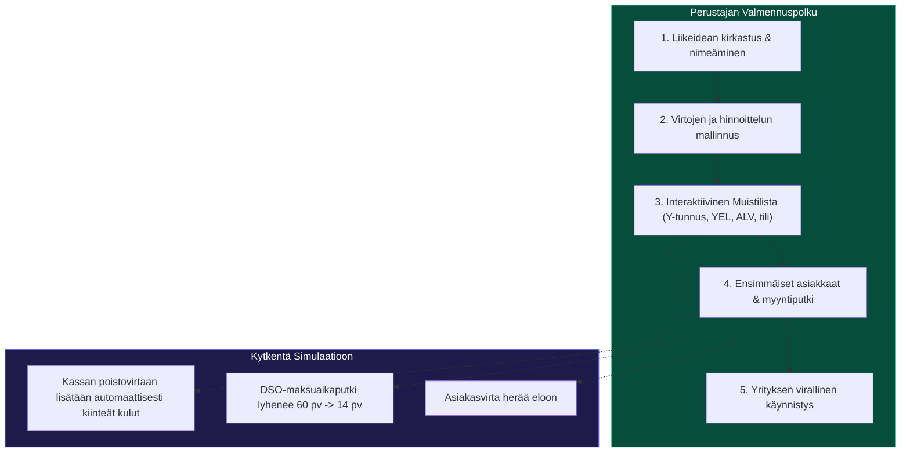
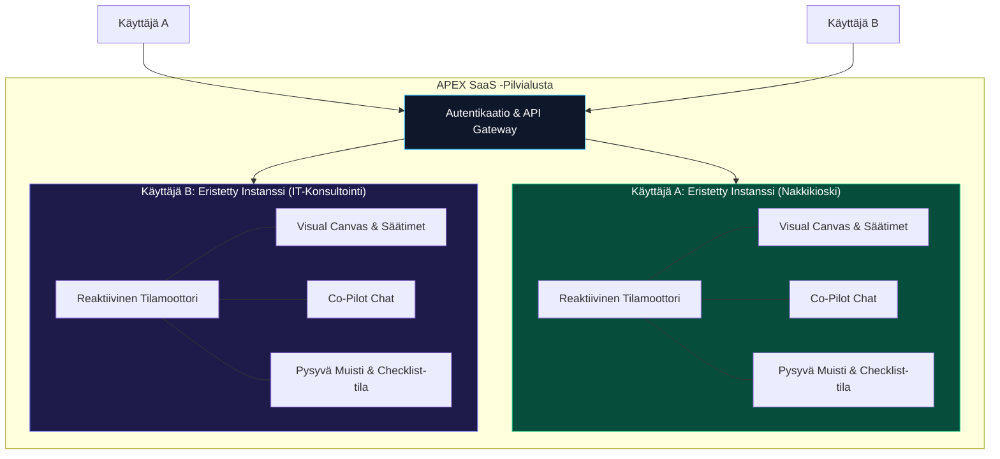

# APEX: Addiktoiva Simulaatio, Virtojen Visualisointi & Master-Tiekartta

> [!IMPORTANT]
> **Ydinfilosofia ja käyttäjän suora ohjaus:**
> 1. **Ei automaattista ERP-monimutkaistumista:** Yrityksen kasvu ei saa koskaan muuttaa käyttöliittymää raskaaksi taulukkoviidakoksi tai byrokraattiseksi pörssiyhtiön ERP-näkymäksi.
> 2. **Koukuttavuus ja palaamisen halu:** Käyttöliittymän on oltava niin elävä, visuaalinen ja palkitseva, että käyttäjä haluaa palata siihen jatkuvasti kokeilemaan eri strategioita.
> 3. **Virtojen visualisointi (Visual Flow Engine):** Kaikki olennainen näkyy elävinä virtoina (raha, asiakkaat, tunnit, pullonkaulat) kuin huippuluokan simulaatiopelissä.
> 4. **Progressive Disclosure (Syvennä klikkaamalla):** Pääruutu on aina ilmava ja kristallinkirkas. Syvälliset ammattilaistyökalut, lisämoduulit ja tase-erittelyt avautuvat *vain ja ainoastaan silloin*, kun käyttäjä itse klikkaa elementtiä syvemmälle.
> 5. **Keskusteleva Äly & Dynaaminen Laajennettavuus (In-Flight Mutation):** Chat ei ole erillinen sivupalkki, vaan yrityksen "elävä aivo". Käyttäjä voi pyytää chatissa uusia laatikoita, funktioita, kuluja tai ansaintalogiikoita, ja ne syntyvät suoraan visuaaliseen malliin lennossa.
> 6. **Aito Agnostisuus – Atomiset Virtaelementit (Business Molecules):** Hylätään jäykät viisi siiloa. Kaikki maailman liiketoiminnat koostuvat vain viidestä perustason *atomista*, joita voidaan vapaasti yhdistellä hybridimalleiksi.
> 7. **Monipuoliset Käyttäjäpersoonat & Alajärjestelmän Rajaus (Subsystem Scoping):** Mukautuu opiskelijasta ja aloittavasta yrittäjästä aina osa-aluejohtajaan (joka simuloi vain omaa vastuualuettaan) ja koko yrityksen toimitusjohtajaan.
> 8. **Monikäyttäjä-SaaS ja Pysyvä Muisti (Multi-Tenant SaaS & Persistent Memory):** Jokainen käyttäjä saa oman eristetyn pilvi-instanssinsa. Tekoäly ja simulaatio muistavat kaiken.
> 9. **Proaktiivinen Valmentaja & Perustajan Muistilista (Founder Launchpad & Active Coach):** Järjestelmä valmentaa aloittavaa yrittäjää eteenpäin askel askeleelta interaktiivisella muistilistalla, jonka toimenpiteet kytkeytyvät suoraan simulaation fysiikkaan.
> 10. **Zero-Friction Datan Tuonti & Kova Matematiikka:** Tiliotteen/tuloslaskelman pudotus (CSV/PDF) ja eksakti kipurajalaskenta (Sensitivity Engine).

---

## 1. Proaktiivinen Yritysvalmennus & Perustajan Muistilista (*Founder Launchpad*)

---

## 2. Monikäyttäjä-SaaS ja Pysyvä Muisti (*Persistent Memory Sandbox*)

---

## 3. Kohderyhmät ja Käyttäjäpersoonamatriisi

| Käyttäjäpersoona | Käyttötarkoitus | Miksi APEX on ylivertainen? |
| :--- | :--- | :--- |
| **1. Opiskelija & Oppija** | Opetella hauskasti simulaation muodossa miten yritys ja talous toimivat. | Turvallinen hiekkalaatikko, valmiit hauskat liikeideat (pizzat, pelistudiot). Ei kuivaa teoriaa. |
| **2. Liikeideaa harkitseva aloittaja** | Käynnistää firman alusta asti ja varmistaa että kaikki asiat ovat kunnossa. | **Founder Launchpad & Checklist:** Ohjaa läpi Y-tunnuksen, hinnoittelun, YEL:n ja maksuajat. |
| **3. Toimiva yrittäjä (SME / Solo)** | Pelata oman yrityksen mallinnuksella ja testata hinnoittelua ja rekryjä omilla luvuilla. | Matemaattinen kipuraja-analyysi: *"Paljonko kestän asiakaspoistumaa jos nostan hintaa 20 %?"* |
| **4. Osa-aluejohtaja (Subsystem Lens)** | Simuloida ja johtaa **vain omaa vastuualuettaan** (myynti, tuotanto, HR), ei koko yritystä. | **Subsystem Scoping:** Rajaa pois muun yrityksen ja näyttää vain oman tontin kriittiset vivut. |
| **5. Toimitusjohtaja / Ylin johto** | Simuloida koko yrityksen kokonaisvaltaista orkestrointia ja kassariskejä. | Kaikkien funktioiden yhdistetty makronäkymä ja 12 kk skenaarioajo johtoryhmälle. |
| **6. Yritysvalmentaja & Tilitoimisto** | Visuaalinen sparraustyökalu asiakastapaamisiin korvaamaan kuivat tulosraportit. | Asiakas näkee heti omin silmin, miksi kassa kuivuu vaikka kirjanpidossa näkyy voittoa. |
| **7. Rahoittaja & Enkelisijoittaja** | Hakijan liiketoimintasuunnitelman stressitestaus ennen laina- tai sijoituspäätöstä. | Objektiivinen herkkyystestaus: mitä tapahtuu jos kysyntä sakkaa 25 %? |

---

## 4. Visual Flow Engine & Progressive Disclosure

* **Nestemäinen Kassa-akku:** Kassa visualisoidaan elävänä vesisäiliönä, jossa raha virtaa pulssimaisesti ja maksuajat (DSO) näkyvät konkreettisessa putkessa matkalla.
* **Progressive Disclosure:** Päänäkymä on aina ilmava ja zen-mäisen selkeä (korkeintaan 3–5 päänoodia). Syvät erittelyt avautuvat pehmeänä sivupaneelina vain klikkaamalla.
* **Reaaliaikaiset "Mitä jos?" -säätimet:** Väännä vipua, ja virrat sekä kassa reagoivat alle 16 ms viiveellä.

---

## 5. Aito Agnostisuus: Atomiset Virtaelementit (Business Molecules)

Kaikki maailman liiketoimintamallit koostuvat viidestä universaalista atomista:
1. **Aika- ja Kapasiteettiatomi (`AtomTimeCapacity`):** Kalenteritunnit, käyttöaste, työpisteet, peruutukset (*no-show*).
2. **Aine- ja Varastoatomi (`AtomPhysicalMatter`):** Raaka-aineet, varasto, hävikki, vanhentuminen, toimitusajat.
3. **Jatkuva Tilausatomi (`AtomRecurringSubscription`):** Toistuva kuukausitulo (*MRR*), asiakaspoistuma (*churn*), asiakashankintakulu (*CAC*).
4. **Tapahtuma- ja Kauppa-atomi (`AtomTransactionalTrade`):** Asiakasvirta, tiski/kassa, keskiostos, välitön maksutapahtuma.
5. **Maksuaika- ja Sitoumusatomi (`AtomCreditWorkingCapital`):** Asiakkaiden maksuajat (*DSO*), ostovelat (*DPO*), ennakkomaksut, kassakuilu ennen suorituksia.

---

## 6. Keskusteleva Äly & Dynaaminen Mallin Laajennus (In-Flight Mutation)

Käyttäjä voi keskustella yrityksensä kanssa luonnollisella kielellä ja luoda uusia virtoja suoraan lennossa:
* *"Lisää mulle Wolt-kotiinkuljetus 30 % komissiolla."* $\to$ Ruudulle animoituu uusi Wolt-myyntikanava liukusäätimineen.
* *"Mitä jos otan alihankkijan tasaamaan ruuhkahuippuja 65 €/h?"* $\to$ Toimitusketjuun ilmestyy joustava alihankintaputki.

---

## 7. Kehittyneet Simulaatio-ominaisuudet

1. **Matemaattinen Kipuraja-analyysi (Break-Even Sensitivity):** Eksakti katelaskenta ilman arvauksia: *"Paljonko kestät asiakaspoistumaa ennen kuin hinnan korotus kääntyy tappiolliseksi?"*
2. **Aikakone & Moniversumi-skenaariot (A/B Multiverse):** Rinnakkaisten strategioiden visualisointi ja vertailu rinnakkain ruudulla.
3. **Yrittäjän Elanto & Jaksaminen (Founder Fuel Loop):** Yrittäjän oma palkkanosto, unitunnit ja burnout-riski.
4. **Dynaaminen Maailma & Sesongit:** Ulkoiset shokit ja sesonkivaihtelut.

---

## 8. Tiekartta v3.2 (päivitetty 24.10.2026)

> [!NOTE]
> **v2-perusta (vaiheet 1–14) on valmis** ja GitHubissa (85/85 testiä). v3.2 rakentuu sen päälle eikä hylkää mitään: atomiydin, kaavat, herkkyys, valmentaja, tuonti, kielituki ja widgetit säilyvät. Tekninen määrittely: `docs/APEX_TECHNICAL_SPECIFICATION_DOCUMENT.md` (v3.2-PRO-SPEC).

### v2-perusta (valmis)

| Vaihe | Nimi | Tila |
| :-: | :-- | :-- |
| 1–8 | Virtanäkymä, paneelit, kipurajat, atomimalli, tiliotteen tuonti, perustamislista, roolit, valmentaja | ✅ |
| 9–11 | Kielituki FI/EN, APEX Studio yhtenä sovelluksena, prompt-to-widget | ✅ |
| 12–14 | Skenaariot ja Monte Carlo, neuvonantajat, lukujen alkuperä, raportti, toteuma, sesongit ja kriisit | ✅ |

### v3.2-tiekartta: APEX Studio yhtenäiseksi

| Vaihe | Nimi | Sisältö | Hyväksymisehto |
| :-: | :-- | :-- | :-- |
| **V1** | Käyttöliittymän yhdistäminen | 5-vyöhykkeinen kuori (komentopalkki, navigaattori, kangas, tarkastelija, aikajana). Classic-väritokenit Studioon. Classicin rahoitus-, operaatio- ja organisaatiopaneelien ulkoasu siirretään Studioon, toistaiseksi atomidatan päällä. Tekstit `t()`:n kautta. **Kypsyystaso:** persoona valitsee oletustason (suunnittelija 0, yrittäjä ja johtaja 3), kyvykkyyskartta-näkymä tasoille 0–1, käsiteselitykset opiskelijalle. **Invariantti A3:** Spotlight Viewport Isolation (valittu solmu ja sen 3–7 lasta kirkkaina, muu himmeänä, portit näkyvissä) alkuun atomidatalla. **A4 (nopeus 1):** kaikki säätimet ja valinnat paikallisesti <16 ms, mitattu selaintestillä. | Kaikki nykyiset toiminnot toimivat uudessa kuoressa. FI/EN toimii. Vanhat testit vihreinä. |
| **V2** | Universaali prosessigraafi | `src/flow/graph/`: solmut (L0–L5), ICOM-portit, hierarkkiset virrat, `EntityURI`-rekisteri, validointi, simulaattori ja pääkirja (eriytetään `core/engine/ledger.ts`:stä). **A1:** viisi atomia solmun `physics`-moduuleiksi (`PhysicsModule`), ei rinnakkaista molekyylimallia; `migrateMoleculeToGraph` ja vanhojen mallien siirto. Semanttinen zoom solmuille ja virroille. **Kypsyystaso:** `maturity`, `definition` (defined/named/unknown) ja `BusinessCapability` mukana tyypeissä alusta asti; simulaattori ohittaa määrittelemättömät solmut. **A3:** Natural Capability Zoom: roolit/FTE:t, IT-järjestelmät ja resurssit paljastuvat tasoilla L2–L4 tai IT/Org-linssissä, ei L0–L1:llä. **Valmiuskriteeri:** jokaisella lehdellä ≥1 fysiikkamoduuli, ja neljän esimerkin kultaiset testit täsmäävät (≤0,5 %). | Golden-testit: graafi vs. atomiydin neljällä esimerkkimallilla, ero ≤ 0,5 %. Tase täsmää joka kuukausi. 300 lehtisolmua × 360 kk < 16 ms (muuten Web Worker). |
| **V3** | Genesis-to-Operations | 8 vaihetta (ongelma → ratkaisu → markkina → asiakkaat → hankinta → ansaintamalli → kyvykkyydet → topologia ja hallinto) ja 6-portainen deterministinen kääntäjä. **A2:** Fast-Track Genesis (yksi lause tai CSV/PDF → `UniversalGenesisSpec` taustalla → graafi heti) ja Architect Mode (kaikki 8 vaihetta). Founder Launchpad on kankaan päällä toimiva valmentaja, jonka valinnat kytkeytyvät ICOM-portteihin ja kassaan (ei toista aloitusvelhoa). **Kypsyystaso:** kääntäjä noudattaa tasoa (4.2 vaihe 0), `gaps.ts` aukkoanalyysi ja selkokielinen yhteenveto uhista, kuluista ja huomioitavista asioista, kyvykkyysmalli ja huomioitavien asioiden pohjat dataa (`src/flow/graph/capabilities/`). Täysi end-to-end on tason 3 valinta. | Sama syöte tuottaa aina saman graafin. Ei toimialaoletuksia koodissa (testi). Taso 0 -malli ei sisällä prosessisolmuja, ja aukkoyhteenveto toimii ainakin kolmella eri datapohjalla. |
| **V4** | Mekanismit, linssit ja roolit | IT-järjestelmät, roolit ja resurssit solmujen mekanismiportteihin. 4 X-Ray-linssiä (operaatiot, kate-Sankey, IT ja data, organisaatio ja vastuut). Persona-HUD ja osa-alueen rajaus (subsystem scoping). | Linssit näyttävät saman graafin eri tavoin ilman eri dataa. Osa-aluejohtaja näkee vain oman alueensa ja sen rajapinnat. Kyvykkyyslinssi (taso 0–1) ja osastorajaus toimivat kaikilla tasoilla. **A4:** `OptimisticNodePatch`: paikallinen `intent.ts` luo ghost-solmun <50 ms, rollback yhdellä siirtymällä. Ghostin lukuja ei lasketa malliin. |
| **V5** | Älykäs muokkaus ja analyysi graafilla | Valmentajan muutokset `GraphCommand`-komennoiksi (tarkistetut, kumottavat). Tuonti pääkirjaan ja solmuille. Herkkyys, stressi ja Monte Carlo graafin kertoimille. Widgetit lukevat `EntityURI`-viitteitä. **A4:** `orchestrator.ts` (asynkroninen kielimallikutsu) hydratoi ghost-solmun palasina (`AsyncLLMHydration`). **Valmiuskriteeri:** simuloidun 5 s kielimalliviiveen aikana säätimet ja animaatiot toimivat, ja epäonnistuminen tai peruutus palauttaa tilan. | Tekoäly ei koskaan aja koodia. Jokainen muutos on kumottavissa ja näkyy alkuperätiedoissa. |
| **V6** | Classicin poisto | `/classic`-reitti, `src/app/`, `src/components/` ja `src/core/` poistetaan, kun korvaavat testit ovat vihreinä. | Kaikki Classicin ominaisuudet löytyvät Studiosta. |
| **V7** | Pilvi ja integraatiot | Käyttäjätilit, eristetyt instanssit ja pysyvä muisti, neuvojan asiakasmallit. Kirjanpito- ja ERP-rajapinnat (Procountor, Netvisor ym.). | Tiedot eristetty käyttäjittäin. |
| – | Kaupallistaminen | Myöhemmin. Sitä ennen jatkuvaa omaa ja tuttujen testausta. | |

**Sääntö joka vaiheessa:** toimialaan tai kokoluokkaan lukittuja oletuksia ei saa olla koodissa (esimerkit ovat vain dataa), kaikki testit pysyvät vihreinä, ja jokainen vaihe viedään GitHubiin omana committinaan.

### Kypsyystasot (v3.1) ja invariantit (v3.2)

Studio ei avaa end-to-end-prosesseja ennen kuin käyttäjä on päättänyt mitä yritys tekee: taso 0 Idea (kyvykkyyskartta), 1 Konsepti, 2 Toimintamalli, 3 Toiminta. Tason valitsee aina käyttäjä. Työt on kirjattu suoraan vaiheiden V1–V4 riveihin yllä. Määrittely: TSD kohta 4.4.
