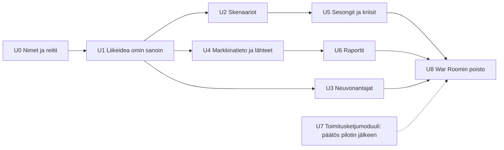

# Suunnitelma: yksi APEX, kaksi kieltä ja päivitetty tiekartta

> [!IMPORTANT]
> **Kaksi päätöstä sinulle** (lopussa): 1) mikä nimi War Roomin tilalle, 2) siirretäänkö pilotti ennen pilvipalvelua.

---

## 1. War Roomin ja Flow'n yhdistäminen

### Arkkitehtuuripäätös: Flow'n malli on pohja, War Roomin hyvät osat siirretään sen päälle

Kahden moottorin yhdistäminen yhdeksi olisi kallista ja säilyttäisi juuri sen ongelman, josta lähdimme liikkeelle. Luontevin tapa on kuristajaviikuna-malli (*strangler fig*): uusi rakenne kasvaa vanhan ympärille, ja vanha poistetaan pala kerrallaan, kun uusi vastaa sitä.

| | War Room (nykyinen) | Flow (uusi) |
| :-- | :-- | :-- |
| Laskentamalli | Rakennettu tehtaan ehdoilla: toimittajat, varastoerät, tuotantolinjat (noin 20 000 riviä) | Toimialasta riippumattomat atomit, noin 5 000 riviä |
| Tila | **Yksi yhteinen istunto palvelimella**: kaikki käyttäjät jakaisivat saman yrityksen | Jokaisella käyttäjällä oma malli selaimessa: sopii suoraan monikäyttäjäpalveluun |
| Vaste | Jokainen muutos on palvelinkutsu | Liukusäädin päivittää näkymän alle millisekunnissa |
| Vahvuudet, jotka kannattaa säilyttää | Liikeidea omin sanoin, tekoälyneuvonantajat, markkinatieto, skenaariohaarat, Monte Carlo, kriisit, raportin vienti | Virtakuva, kipurajat, perustamislista, valmentaja, roolit, tiliotteen tuonti |

**Johtopäätös:** Flow'n atomimalli on ainoa laskentamalli. War Roomin arvokkaat ominaisuudet kirjoitetaan uudelleen atomimallin päälle moduuleiksi, jotka avautuvat klikkaamalla. War Room poistetaan, kun vastaavat ominaisuudet ovat valmiit.

### Nimi: ehdotukset War Roomin tilalle

Koko tuote on **APEX**. "War Room" poistuu, ja sen osat nimetään neutraalisti. Nimien pitää toimia sekä suomeksi että englanniksi.

| Vaihtoehto | Mitä se kuvaa | Arvio |
| :-- | :-- | :-- |
| **APEX Studio** *(suositus)* | Yksi työtila, jossa rakennetaan ja kokeillaan | Sama sana suomeksi ja englanniksi, neutraali ja luova sävy |
| APEX Työpöytä / Workspace | Arkinen työväline | Selkeä, mutta käännös vaihtuu |
| APEX Ohjaamo / Cockpit | Hallinnan tunne | Vähän dramaattinen, mutta paljon War Roomia lievempi |

War Roomin osien uudet nimet (suomi / englanti):

| War Room | Uusi nimi | Mihin se tulee |
| :-- | :-- | :-- |
| Genesis | **Aloitus / Start** | aloitussivun teksti "Kerro liikeideasi" |
| War Room Briefing | **Tilannekatsaus / Briefing** | valmentajan paneeli |
| Debate Panel (tekoälyjohtoryhmä) | **Neuvonantajat / Advisors** | oma paneeli |
| Timeline Branches, Monte Carlo | **Skenaariot / Scenarios** | oma näkymä |
| Market Research | **Markkinatieto / Market data** | paneeli, joka kalibroi oletuksia lähteineen |
| Executive Export | **Raportti / Report** | vienti |

### Vaiheet

| Vaihe | Sisältö | Mistä War Roomista |
| :-- | :-- | :-- |
| **U0** | `/` avaa APEX Studion (nykyinen Flow). War Room siirtyy osoitteeseen `/classic` nimellä "Klassinen näkymä (poistumassa)". Koodin War Room -nimet vaihdetaan. | reitit, nimet |
| **U1** | Aloitussivulle "Kerro liikeideasi omin sanoin". Kielimalli palauttaa **samat tarkistetut komennot**, joilla valmentaja jo muuttaa mallia (tulovirrat, kulut, maksuehdot). Ilman kielimallia avainsanat ohjaavat sopivaan esimerkkipohjaan. War Roomin järkevyystarkistus (*sense check*) muuttuu valmentajan havainnoiksi. | Genesis, kääntäjä, sense check |
| **U2** | Skenaariot: mallista voi haarauttaa versiot A ja B, joiden kassakäyrät näkyvät rinnakkain. Monte Carlo laskee vaihteluvälit, jotka **käyttäjä itse antaa** (esim. myynti 80–120 %); epävarmuutta ei arvata. Tämä on samalla tiekartan aikakone. | Timeline Branches, Monte Carlo |
| **U3** | Neuvonantajat: tekoälyjohtoryhmä (talous, myynti, toimitus, henkilöstö) keskustelee mallin oikeista luvuista. Ilman kielimallia valmentajan havainnot jaetaan rooleittain. | Debate Panel, agents |
| **U4** | Markkinatieto: haku kalibroi oletuksia **lähdeviitteineen**. Jokaisella luvulla näkyy alkuperä: *oma arvio / tiliote / markkinatieto / valmentaja / perustamislista*. Tämä toteuttaa War Roomin `*`-merkinnät. | Market Research, oletusten `*` |
| **U5** | Malliin kuukausittaiset kertoimet: sesongit (jäätelökioskin kesä) ja kriisit, joissa käyttäjä tekee päätöksen. | Crisis cards, living world |
| **U6** | Liiketoimintasuunnitelma tai raportti mallista (Markdown, myöhemmin PDF) rahoittajalle tai pankille. | Executive Export |
| **U7** | Toimitusketju- ja varastoerämoduuli valmistaville yrityksille: **päätetään pilotin palautteen perusteella**. Suositus: ei siirretä etukäteen. | warehouse, supply |
| **U8** | War Room ja sen testit poistetaan, kun kaikelle siirretylle on vastaavat testit Flow'n puolella. | koko `src/app`, `src/core` |

---

## 2. Kieli: suomi ja englanti

### Periaatteet
1. **Kieli ja maa ovat eri asioita.** YEL, PRH ja ALV ovat Suomen lakia, eivät suomen kieltä. Englanninkielinen käyttäjä voi perustaa yrityksen Suomeen ("Finnish entrepreneur's pension insurance (YEL)"). Siksi perustamislistan sisältö on **maapaketti** (`FI`), joka on erillään kielestä. Myöhemmin samaan rakenteeseen voi lisätä muita maita.
2. **Laskentaytimessä ei ole tekstiä.** Ydin on jo nyt lähes kielivapaa; vain esimerkkien nimet ja tulovirtojen otsikot siirretään käännöksiin.
3. **Kääntämättä jääneet tekstit huomataan testeissä.** Englanninkielisellä tiedostolla on sama tyyppi kuin suomenkielisellä, ja testi tarkistaa, että avaimet ja muuttujat täsmäävät.

### Vaiheet

| Vaihe | Sisältö | Koko |
| :-- | :-- | :-- |
| **I1 Perusta** | Käännöstiedostot `fi.ts` ja `en.ts`, käännösfunktio `t(avain, arvot)`, luvut ja päivämäärät kielen mukaan (`1 234 €` vs `€1,234`). Kielivalinta yläpalkkiin ja `?lang=en`; oletus selaimen kielestä; valinta tallentuu. | pieni |
| **I2 Tekstien siirto** | Noin 400 tekstiä: pääkortit, valmentaja, perustamislista, vivut, paneelit, roolit, tuonti. Kaavat ja selitykset käännetään sisältöineen. | suurin |
| **I3 Keskustelu** | Kielimallille ohje vastata käyttäjän kielellä. Komentotulkkiin englanninkieliset muodot ("raise prices 10%", "payment terms 14 days", "hire", "add cost office 600"). | pieni |
| **I4 Maapaketti ja ohjeet** | Perustamislista dataksi (`FI`), viranomaisluvut yhteen tarkistettavaan paikkaan, englanninkielinen käyttöohje. | pieni |

**Miksi kieli ennen yhdistämistä?** Kaikki yhdistämisessä siirrettävä koodi kirjoitetaan silloin heti kaksikieliseksi. War Roomia ei käännetä lainkaan, koska se poistetaan.

---

## 3. Miten roolit vaikuttavat tällä hetkellä

**Rehellinen vastaus: kevyesti.** Rooli ei muuta laskentaa, eikä se lukitse tai avaa toimintoja. Se muuttaa sen, mitä näytetään ja korostetaan.

| Rooli | Näkökulman valinta | Stressitestit päänäkymässä | Perustamislista korostettuna | *Opi:*-selitykset | Muuta |
| :-- | :-: | :-: | :-: | :-: | :-- |
| Opiskelen | – | – | – | ✓ | Seuraava askel -ehdotukset; kysyntäoletuksesta ei huomauteta |
| Perustan yritystä | – | – | ✓ | ✓ | Seuraava askel -ehdotukset |
| Pyöritän yritystä | – | ✓ | – | – | |
| Johdan osa-aluetta | ✓ (oletus Myynti) | – | – | – | |
| Johdan yritystä | ✓ | ✓ | – | – | |
| Neuvon asiakkaita | ✓ | ✓ | ✓ | ✓ | |
| Arvioin rahoitusta | ✓ (oletus Talous) | ✓ | – | – | |

**Näkökulma** (Myynti / Toimitus / Talous) on roolien näkyvin vaikutus: vivut, pääkortit, himmennetyt solmut ja rajapintaviestit vaihtuvat.

**Puutteet:**
- *Pyöritän yritystä* ja *Johdan yritystä* eroavat toisistaan vain näkökulman valinnan osalta.
- Opiskelija ei saa tehtäviä eikä tavoitteita, vain selityksiä.
- Neuvojalla ei ole asiakkaita (useita malleja), ja rahoittajalla ei ole raporttia.
- Paneelit ovat kaikille samat.

**Ehdotetut parannukset tiekarttaan:**

| Rooli | Parannus | Vaihe |
| :-- | :-- | :-- |
| Opiskelija | **Tehtävät:** esim. "Pelasta kassa", "Löydä kannattavuusraja", "Kestä −25 % myynti". Tavoite ja tarkistus. Myöhemmin opettajatila. | 11 |
| Perustaja | Liikeidea omin sanoin (U1) | 10 |
| Yrittäjä | Toteutuma vs. suunnitelma: tiliote rinnakkain mallin kanssa | 13 |
| Osa-aluejohtaja | Tavoitteet näkökulmalle (esim. myyntikate ≥ 40 %), ja rajapinta varoittaa, jos ne rikkoutuvat | 12 |
| Toimitusjohtaja | Skenaariovertailu ja neuvonantajat (U2, U3) | 12–13 |
| Neuvoja | Useita asiakasmalleja ja jaettava linkki (vaatii pilven) | 15 |
| Rahoittaja | Stressiruudukko, vaihteluvälit ja raportti (U2, U6) | 12–13 |

---

## 4. Päivitetty tiekartta

| Vaihe | Nimi | Tila |
| :-: | :-- | :-- |
| 1–8 | Virtanäkymä, paneelit, kipurajat, atomimalli, tiliotteen tuonti, perustamislista, roolit, valmentaja | ✅ **Valmis** (61 testiä, GitHub) |
| **9** | **Kielituki FI / EN** (I1–I4) | 🆕 seuraava |
| **10** | **APEX Studio** (U0–U1): nimet, reitit, liikeidea omin sanoin → malli | 🆕 |
| **11** | **Pilotti 5–10 käyttäjällä** sekä palautetyökalu sovelluksessa ja opiskelijan tehtävät | ⬆️ siirretty aiemmaksi (oli 11/12) |
| 12 | Skenaariot ja aikakone (U2), yrittäjän jaksaminen, osa-alueiden tavoitteet | (oli 10) |
| 13 | Neuvonantajat, markkinatieto lähteineen, raportti, toteutuma vs. suunnitelma (U3, U4, U6) | 🆕 War Roomista |
| 14 | Sesongit ja kriisit (U5) | (tiekartan kohta 7.4) |
| 15 | Pilvi, käyttäjätilit ja pysyvä muisti, neuvojan asiakasmallit | ⬇️ siirretty myöhemmäksi (oli 9) |
| 16 | War Roomin poisto; päätös toimitusketjumoduulista (U7–U8) | 🆕 |
| 17 | Kirjanpitorajapinnat (Procountor, Netvisor) | (oli 12) |

**Miksi pilotti ennen pilveä?** Saamasi kriittinen palaute osui tähän: maksuhalukkuus pitää todistaa ennen raskasta infraa. Pilotti onnistuu ilman pilveä, koska malli tallentuu testaajan selaimeen. Pilvi rakennetaan vasta, kun tiedetään, mitä käyttäjät oikeasti tekevät.

---

## 5. Päätökset sinulle

1. **Nimi:** APEX Studio (suositus), APEX Työpöytä / Workspace vai APEX Ohjaamo / Cockpit, vai jokin muu?
2. **Järjestys:** hyväksytkö, että pilotti (11) tulee ennen pilvipalvelua (15)? Vaihtoehto on pitää alkuperäinen järjestys, jossa pilvi rakennetaan ensin.

Kun nämä on päätetty, aloitan vaiheesta 9 (kielituki).
