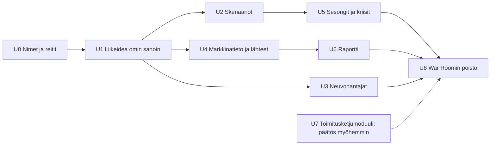
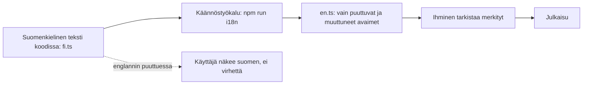

# Suunnitelma: yksi APEX, kaksi kieltä ja päivitetty tiekartta

> [!NOTE]
> **Päätökset tehty 22.10.2026:** nimi on **APEX Studio**, pilottia ei tehdä (rakennetaan pitkälle, testataan itse) ja vaiheet 9–14 ovat työn alla. Kielituen toteutustapa on kuvattu luvussa 2.

---

## 1. War Roomin ja Flow'n yhdistäminen

### Arkkitehtuuripäätös: Flow'n malli on pohja, War Roomin hyvät osat siirretään sen päälle

Kahden moottorin yhdistäminen yhdeksi olisi kallista ja säilyttäisi juuri sen ongelman, josta lähdimme liikkeelle. Luontevin tapa on kuristajaviikuna-malli (*strangler fig*): uusi rakenne kasvaa vanhan ympärille, ja vanha poistetaan pala kerrallaan, kun uusi vastaa sitä.

| | War Room (nykyinen) | Flow (uusi) |
| :-- | :-- | :-- |
| Laskentamalli | Rakennettu tehtaan ehdoilla: toimittajat, varastoerät, tuotantolinjat (noin 20 000 riviä) | Toimialasta riippumattomat atomit, noin 5 000 riviä |
| Tila | **Yksi yhteinen istunto palvelimella**: kaikki käyttäjät jakaisivat saman yrityksen | Jokaisella käyttäjällä oma malli selaimessa: sopii suoraan monikäyttäjäpalveluun |
| Vaste | Jokainen muutos on palvelinkutsu | Liukusäädin päivittää näkymän alle millisekunnissa |
| Vahvuudet, jotka kannattaa säilyttää | Liikeidea omin sanoin, tekoälyneuvonantajat, markkinatieto, skenaariohaarat, Monte Carlo, kriisit, raportin vienti | Virtakuva, kipurajat, perustamislista, valmentaja, roolit, tiliotteen tuonti |

**Johtopäätös:** Flow'n atomimalli on ainoa laskentamalli. War Roomin arvokkaat ominaisuudet kirjoitetaan uudelleen atomimallin päälle moduuleiksi, jotka avautuvat klikkaamalla. War Room poistetaan, kun vastaavat ominaisuudet ovat valmiit.

### Nimi: ehdotukset War Roomin tilalle

Koko tuote on **APEX**. "War Room" poistuu, ja sen osat nimetään neutraalisti. Nimien pitää toimia sekä suomeksi että englanniksi.

| Vaihtoehto | Mitä se kuvaa | Arvio |
| :-- | :-- | :-- |
| **APEX Studio** *(suositus)* | Yksi työtila, jossa rakennetaan ja kokeillaan | Sama sana suomeksi ja englanniksi, neutraali ja luova sävy |
| APEX Työpöytä / Workspace | Arkinen työväline | Selkeä, mutta käännös vaihtuu |
| APEX Ohjaamo / Cockpit | Hallinnan tunne | Vähän dramaattinen, mutta paljon War Roomia lievempi |

War Roomin osien uudet nimet (suomi / englanti):

| War Room | Uusi nimi | Mihin se tulee |
| :-- | :-- | :-- |
| Genesis | **Aloitus / Start** | aloitussivun teksti "Kerro liikeideasi" |
| War Room Briefing | **Tilannekatsaus / Briefing** | valmentajan paneeli |
| Debate Panel (tekoälyjohtoryhmä) | **Neuvonantajat / Advisors** | oma paneeli |
| Timeline Branches, Monte Carlo | **Skenaariot / Scenarios** | oma näkymä |
| Market Research | **Markkinatieto / Market data** | paneeli, joka kalibroi oletuksia lähteineen |
| Executive Export | **Raportti / Report** | vienti |

### Vaiheet

| Vaihe | Sisältö | Mistä War Roomista |
| :-- | :-- | :-- |
| **U0** | `/` avaa APEX Studion (nykyinen Flow). War Room siirtyy osoitteeseen `/classic` nimellä "Klassinen näkymä (poistumassa)". Koodin War Room -nimet vaihdetaan. | reitit, nimet |
| **U1** | Aloitussivulle "Kerro liikeideasi omin sanoin". Kielimalli palauttaa **samat tarkistetut komennot**, joilla valmentaja jo muuttaa mallia (tulovirrat, kulut, maksuehdot). Ilman kielimallia avainsanat ohjaavat sopivaan esimerkkipohjaan. War Roomin järkevyystarkistus (*sense check*) muuttuu valmentajan havainnoiksi. | Genesis, kääntäjä, sense check |
| **U2** | Skenaariot: mallista voi haarauttaa versiot A ja B, joiden kassakäyrät näkyvät rinnakkain. Monte Carlo laskee vaihteluvälit, jotka **käyttäjä itse antaa** (esim. myynti 80–120 %); epävarmuutta ei arvata. Tämä on samalla tiekartan aikakone. | Timeline Branches, Monte Carlo |
| **U3** | Neuvonantajat: tekoälyjohtoryhmä (talous, myynti, toimitus, henkilöstö) keskustelee mallin oikeista luvuista. Ilman kielimallia valmentajan havainnot jaetaan rooleittain. | Debate Panel, agents |
| **U4** | Markkinatieto: haku kalibroi oletuksia **lähdeviitteineen**. Jokaisella luvulla näkyy alkuperä: *oma arvio / tiliote / markkinatieto / valmentaja / perustamislista*. Tämä toteuttaa War Roomin `*`-merkinnät. | Market Research, oletusten `*` |
| **U5** | Malliin kuukausittaiset kertoimet: sesongit (jäätelökioskin kesä) ja kriisit, joissa käyttäjä tekee päätöksen. | Crisis cards, living world |
| **U6** | Liiketoimintasuunnitelma tai raportti mallista (Markdown, myöhemmin PDF) rahoittajalle tai pankille. | Executive Export |
| **U7** | Toimitusketju- ja varastoerämoduuli valmistaville yrityksille: **päätetään oman testauksen perusteella**. Suositus: ei siirretä etukäteen. | warehouse, supply |
| **U8** | War Room ja sen testit poistetaan, kun kaikelle siirretylle on vastaavat testit Flow'n puolella. | koko `src/app`, `src/core` |

---

## 2. Kieli: suomi ja englanti ilman kaksinkertaista työtä

### Periaate: kirjoita kerran, käännä työkalulla
Tekstit kirjoitetaan **vain suomeksi**, ja suomi on lähdekieli. Englanti tuotetaan työkalulla ja tarkistetaan ihmisen toimesta. Kukaan ei kirjoita samaa tekstiä kahteen kertaan, eikä englanti koskaan estä julkaisua.

| Osa | Miten |
| :-- | :-- |
| **Lähde** | `fi.ts` on ainoa paikka, jonne tekstit kirjoitetaan. Koodissa ei ole kovakoodattuja tekstejä (testi tarkistaa tämän). |
| **Käännös** | Työkalu vertaa suomen tiivisteitä (hash) englantiin ja kääntää vain **uudet ja muuttuneet** avaimet käyttäjän omalla API-avaimella (sama BYOK kuin muualla). Käännökset merkitään *"tarkistamatta"*, kunnes joku hyväksyy ne. |
| **Sanasto** | Yksi sanastotiedosto pitää termit yhtenäisinä: kate = *contribution margin*, kannattavuusraja = *break-even point*, myyntisaaminen = *accounts receivable*, YEL = *YEL (Finnish entrepreneur's pension insurance)*. Työkalu saa sanaston mukaan, ja siksi talouden termit eivät vaihtele. |
| **Varakieli** | Jos englanninkielinen teksti puuttuu tai on tarkistamatta, käyttäjä näkee suomen eikä sovellus kaadu. Englanti voi valmistua vähitellen. |
| **Muuttuva sisältö** | Valmentajan lauseet rakennetaan **mallipohjista ja luvuista**, ei valmiista lauseista. Näin jokainen lause käännetään kerran, ja luvut ja päivämäärät muotoillaan kielen mukaan (`1 234 €` vs `€1,234`). |
| **Käyttäjän oma sisältö** | Yrityksen nimi, tulovirtojen nimet ja keskustelu pysyvät käyttäjän kielellä, joten niitä ei käännetä. Kielimalli vastaa käyttäjän kielellä yhdellä lisäohjeella. |
| **Maa erillään kielestä** | Perustamislistan viranomaisasiat (YEL, PRH, ALV) ovat Suomen **maapaketti**. Englanninkielinen käyttäjä voi perustaa yrityksen Suomeen, ja maapaketin selitykset käännetään samalla työkalulla. |

### Mitä emme tee
- **Emme käännä sovellusta lennossa kielimallilla jokaiselle käyttäjälle:** se maksaisi tokeneita jokaisella käynnillä, tulos vaihtelisi ja talouden termit kääntyisivät väärin.
- **Emme käännä War Roomia:** se poistetaan.
- **Emme pidä englantia suomen kanssa samanaikaisena vaatimuksena:** englanti saa jäädä jälkeen, ja se ei estä uutta ominaisuutta.

### Milloin tämä kannattaa tehdä: heti, mutta kevyesti
Tekstejä on nyt noin 400, ja jokainen uusi ominaisuus lisää niitä. Mitä myöhemmin tekstit siirretään käännöstiedostoon, sitä enemmän siirrettävää on. Pullonkaulaa ei synny, koska englanti on jälkijättöinen.

| Vaihe | Sisältö | Estääkö julkaisun? |
| :-- | :-- | :-: |
| **I1 Perusta** | käännösfunktio `t()`, luku- ja päivämäärämuodot, kielivalinta, tarkistustesti "ei kovakoodattuja tekstejä", sanasto, käännöstyökalu | Ei |
| **I2 Tekstien siirto** | kaikki nykyiset suomenkieliset tekstit siirretään `fi.ts`:ään. Työ on mekaaninen eikä muuta toimintaa. **Tämä on ainoa kertakustannus.** | Ei |
| **I3 Englanti** | työkalu kääntää, ihminen tarkistaa näkyvimmät kohdat (aloitus, pääkortit, valmentaja). Komentotulkkiin lisätään englanninkieliset muodot ("raise prices 10%"). | Ei |
| **Jatkuva** | uusi teksti kirjoitetaan suomeksi `fi.ts`:ään. Työkalu tuottaa englannin, ja tarkistus on osa julkaisua, mutta ei sen este. | Ei |

**Oma testaus voidaan tehdä suomeksi.** Englannin tarkistus ja käyttöohje tulevat julkaisulle ennen kansainvälistä jakelua. Perusta (I1–I2) tehdään silti ennen yhdistämistä, jotta War Roomista siirretty koodi kirjoitetaan heti `t()`-kutsuilla.

## 3. Miten roolit vaikuttavat tällä hetkellä

**Rehellinen vastaus: kevyesti.** Rooli ei muuta laskentaa, eikä se lukitse tai avaa toimintoja. Se muuttaa sen, mitä näytetään ja korostetaan.

| Rooli | Näkökulman valinta | Stressitestit päänäkymässä | Perustamislista korostettuna | *Opi:*-selitykset | Muuta |
| :-- | :-: | :-: | :-: | :-: | :-- |
| Opiskelen | – | – | – | ✓ | Seuraava askel -ehdotukset; kysyntäoletuksesta ei huomauteta |
| Perustan yritystä | – | – | ✓ | ✓ | Seuraava askel -ehdotukset |
| Pyöritän yritystä | – | ✓ | – | – | |
| Johdan osa-aluetta | ✓ (oletus Myynti) | – | – | – | |
| Johdan yritystä | ✓ | ✓ | – | – | |
| Neuvon asiakkaita | ✓ | ✓ | ✓ | ✓ | |
| Arvioin rahoitusta | ✓ (oletus Talous) | ✓ | – | – | |

**Näkökulma** (Myynti / Toimitus / Talous) on roolien näkyvin vaikutus: vivut, pääkortit, himmennetyt solmut ja rajapintaviestit vaihtuvat.

**Puutteet:**
- *Pyöritän yritystä* ja *Johdan yritystä* eroavat toisistaan vain näkökulman valinnan osalta.
- Opiskelija ei saa tehtäviä eikä tavoitteita, vain selityksiä.
- Neuvojalla ei ole asiakkaita (useita malleja), ja rahoittajalla ei ole raporttia.
- Paneelit ovat kaikille samat.

**Ehdotetut parannukset tiekarttaan:**

| Rooli | Parannus | Vaihe |
| :-- | :-- | :-- |
| Opiskelija | **Tehtävät:** esim. "Pelasta kassa", "Löydä kannattavuusraja", "Kestä −25 % myynti". Tavoite ja tarkistus. Myöhemmin opettajatila. | 11 |
| Perustaja | Liikeidea omin sanoin (U1) | 10 |
| Yrittäjä | Toteutuma vs. suunnitelma: tiliote rinnakkain mallin kanssa | 14 |
| Osa-aluejohtaja | Tavoitteet näkökulmalle (esim. myyntikate ≥ 40 %), ja rajapinta varoittaa, jos ne rikkoutuvat | 13 |
| Toimitusjohtaja | Skenaariovertailu ja neuvonantajat (U2, U3) | 13–14 |
| Neuvoja | Useita asiakasmalleja ja jaettava linkki (vaatii pilven) | 16 |
| Rahoittaja | Stressiruudukko, vaihteluvälit ja raportti (U2, U6) | 13–14 |

---

## 4. Tiekartta v3.2 (päivitetty 24.10.2026)

> [!NOTE]
> **v2-perusta (vaiheet 1–14) on valmis** ja GitHubissa (85/85 testiä). v3.2 rakentuu sen päälle eikä hylkää mitään: atomiydin, kaavat, herkkyys, valmentaja, tuonti, kielituki ja widgetit säilyvät. Tekninen määrittely: `docs/APEX_TECHNICAL_SPECIFICATION_DOCUMENT.md` (v3.2-PRO-SPEC).

### v2-perusta (valmis)

| Vaihe | Nimi | Tila |
| :-: | :-- | :-- |
| 1–8 | Virtanäkymä, paneelit, kipurajat, atomimalli, tiliotteen tuonti, perustamislista, roolit, valmentaja | ✅ |
| 9–11 | Kielituki FI/EN, APEX Studio yhtenä sovelluksena, prompt-to-widget | ✅ |
| 12–14 | Skenaariot ja Monte Carlo, neuvonantajat, lukujen alkuperä, raportti, toteuma, sesongit ja kriisit | ✅ |

### v3.2-tiekartta: APEX Studio yhtenäiseksi

| Vaihe | Nimi | Sisältö | Hyväksymisehto |
| :-: | :-- | :-- | :-- |
| **V1** | Käyttöliittymän yhdistäminen | 5-vyöhykkeinen kuori (komentopalkki, navigaattori, kangas, tarkastelija, aikajana). Classic-väritokenit Studioon. Classicin rahoitus-, operaatio- ja organisaatiopaneelien ulkoasu siirretään Studioon, toistaiseksi atomidatan päällä. Tekstit `t()`:n kautta. **Kypsyystaso:** persoona valitsee oletustason (suunnittelija 0, yrittäjä ja johtaja 3), kyvykkyyskartta-näkymä tasoille 0–1, käsiteselitykset opiskelijalle. **Invariantti A3:** Spotlight Viewport Isolation (valittu solmu ja sen 3–7 lasta kirkkaina, muu himmeänä, portit näkyvissä) alkuun atomidatalla. **A4 (nopeus 1):** kaikki säätimet ja valinnat paikallisesti <16 ms, mitattu selaintestillä. | Kaikki nykyiset toiminnot toimivat uudessa kuoressa. FI/EN toimii. Vanhat testit vihreinä. |
| **V2** | Universaali prosessigraafi | `src/flow/graph/`: solmut (L0–L5), ICOM-portit, hierarkkiset virrat, `EntityURI`-rekisteri, validointi, simulaattori ja pääkirja (eriytetään `core/engine/ledger.ts`:stä). **A1:** viisi atomia solmun `physics`-moduuleiksi (`PhysicsModule`), ei rinnakkaista molekyylimallia; `migrateMoleculeToGraph` ja vanhojen mallien siirto. Semanttinen zoom solmuille ja virroille. **Kypsyystaso:** `maturity`, `definition` (defined/named/unknown) ja `BusinessCapability` mukana tyypeissä alusta asti; simulaattori ohittaa määrittelemättömät solmut. **A3:** Natural Capability Zoom: roolit/FTE:t, IT-järjestelmät ja resurssit paljastuvat tasoilla L2–L4 tai IT/Org-linssissä, ei L0–L1:llä. **Valmiuskriteeri:** jokaisella lehdellä ≥1 fysiikkamoduuli, ja neljän esimerkin kultaiset testit täsmäävät (≤0,5 %). | Golden-testit: graafi vs. atomiydin neljällä esimerkkimallilla, ero ≤ 0,5 %. Tase täsmää joka kuukausi. 300 lehtisolmua × 360 kk < 16 ms (muuten Web Worker). |
| **V3** | Genesis-to-Operations | 8 vaihetta (ongelma → ratkaisu → markkina → asiakkaat → hankinta → ansaintamalli → kyvykkyydet → topologia ja hallinto) ja 6-portainen deterministinen kääntäjä. **A2:** Fast-Track Genesis (yksi lause tai CSV/PDF → `UniversalGenesisSpec` taustalla → graafi heti) ja Architect Mode (kaikki 8 vaihetta). Founder Launchpad on kankaan päällä toimiva valmentaja, jonka valinnat kytkeytyvät ICOM-portteihin ja kassaan (ei toista aloitusvelhoa). **Kypsyystaso:** kääntäjä noudattaa tasoa (4.2 vaihe 0), `gaps.ts` aukkoanalyysi ja selkokielinen yhteenveto uhista, kuluista ja huomioitavista asioista, kyvykkyysmalli ja huomioitavien asioiden pohjat dataa (`src/flow/graph/capabilities/`). Täysi end-to-end on tason 3 valinta. | Sama syöte tuottaa aina saman graafin. Ei toimialaoletuksia koodissa (testi). Taso 0 -malli ei sisällä prosessisolmuja, ja aukkoyhteenveto toimii ainakin kolmella eri datapohjalla. |
| **V4** | Mekanismit, linssit ja roolit | IT-järjestelmät, roolit ja resurssit solmujen mekanismiportteihin. 4 X-Ray-linssiä (operaatiot, kate-Sankey, IT ja data, organisaatio ja vastuut). Persona-HUD ja osa-alueen rajaus (subsystem scoping). | Linssit näyttävät saman graafin eri tavoin ilman eri dataa. Osa-aluejohtaja näkee vain oman alueensa ja sen rajapinnat. Kyvykkyyslinssi (taso 0–1) ja osastorajaus toimivat kaikilla tasoilla. **A4:** `OptimisticNodePatch`: paikallinen `intent.ts` luo ghost-solmun <50 ms, rollback yhdellä siirtymällä. Ghostin lukuja ei lasketa malliin. |
| **V5** | Älykäs muokkaus ja analyysi graafilla | Valmentajan muutokset `GraphCommand`-komennoiksi (tarkistetut, kumottavat). Tuonti pääkirjaan ja solmuille. Herkkyys, stressi ja Monte Carlo graafin kertoimille. Widgetit lukevat `EntityURI`-viitteitä. **A4:** `orchestrator.ts` (asynkroninen kielimallikutsu) hydratoi ghost-solmun palasina (`AsyncLLMHydration`). **Valmiuskriteeri:** simuloidun 5 s kielimalliviiveen aikana säätimet ja animaatiot toimivat, ja epäonnistuminen tai peruutus palauttaa tilan. | Tekoäly ei koskaan aja koodia. Jokainen muutos on kumottavissa ja näkyy alkuperätiedoissa. |
| **V6** | Classicin poisto | `/classic`-reitti, `src/app/`, `src/components/` ja `src/core/` poistetaan, kun korvaavat testit ovat vihreinä. | Kaikki Classicin ominaisuudet löytyvät Studiosta. |
| **V7** | Pilvi ja integraatiot | Käyttäjätilit, eristetyt instanssit ja pysyvä muisti, neuvojan asiakasmallit. Kirjanpito- ja ERP-rajapinnat (Procountor, Netvisor ym.). | Tiedot eristetty käyttäjittäin. |
| – | Kaupallistaminen | Myöhemmin. Sitä ennen jatkuvaa omaa ja tuttujen testausta. | |

**Sääntö joka vaiheessa:** toimialaan tai kokoluokkaan lukittuja oletuksia ei saa olla koodissa (esimerkit ovat vain dataa), kaikki testit pysyvät vihreinä, ja jokainen vaihe viedään GitHubiin omana committinaan.

### Kypsyystasot (v3.1) ja invariantit (v3.2)

Studio ei avaa end-to-end-prosesseja ennen kuin käyttäjä on päättänyt mitä yritys tekee: taso 0 Idea (kyvykkyyskartta), 1 Konsepti, 2 Toimintamalli, 3 Toiminta. Tason valitsee aina käyttäjä. Työt on kirjattu suoraan vaiheiden V1–V4 riveihin yllä. Määrittely: TSD kohta 4.4.

### Vaihe 11: Prompt-to-widget

Käyttäjä pyytää omin sanoin uutta toimintoa, ja kielimalli palauttaa **widgetin kuvauksen** (JSON), ei ohjelmakoodia. Kuvauksen piirtää meidän oma tarkistettu koodimme valmiista palikoista. Näin kielimallin virhe tai manipulointi ei pääse käsiksi käyttäjän tietoihin tai API-avaimeen.

| Palikka | Esimerkki |
| :-- | :-- |
| Luku tai kortti | "Suurimman asiakkaan osuus myynnistä" |
| Laskukaava | tuntikate = (tuntihinta − muuttuva kulu) × laskutusaste. Lasketaan omalla pienellä tulkilla, joka tuntee vain mallin luvut ja peruslaskutoimitukset. |
| "Mitä jos" -vipu | oma liukusäädin mallin lukuun |
| Hälytyssääntö | "varoita, jos kassa < 2 kk kuluja" |
| Kuvaaja tai taulukko | kassa kuukausittain |

- **Hallinta:** päälle/pois-kytkin, muokkaus, poisto ja merkintä *"tekoälyn luoma, pyyntö: …"*. Widgetit tallentuvat mallin mukana, ja luomisen voi kumota.
- **Kustannus:** käyttäjän omat tokenit (nykyinen BYOK-avain). Ilman avainta ovat käytössä valmiit mallipohjat ja jo luodut widgetit.
- **Rajaus:** aidosti uutta laskentalogiikkaa (jota malli ei tunne) tämä ei kata. Se vaatisi erillisen eristetyn ratkaisun, ja siitä päätetään myöhemmin.

---

## 5. Päätökset

| Päätös | Tulos |
| :-- | :-- |
| Nimi War Roomin tilalle | **APEX Studio** ✅ |
| Pilotti | **Poistettu** tiekartasta: rakennetaan mahdollisimman pitkälle, testataan itse ja tuttujen kesken, kaupallistetaan myöhemmin ✅ |
| Prompt-to-widget | **Vaihe 11** ✅ |
| Kielituen toteutustapa | Kirjoita kerran suomeksi, englanti työkalulla, varakieli suomi ✅ |
| v3.2-arkkitehtuuri | Universaali prosessigraafi, kypsyystasot 0–3 (idea → toiminta) `src/flow/graph/`, ei sidosta `src/core/engine`:en, Classic poistuu vaiheessa V6 ✅ |

Seuraava askel: vaiheet V1 (käyttöliittymän yhdistäminen) ja V2 (prosessigraafi).
